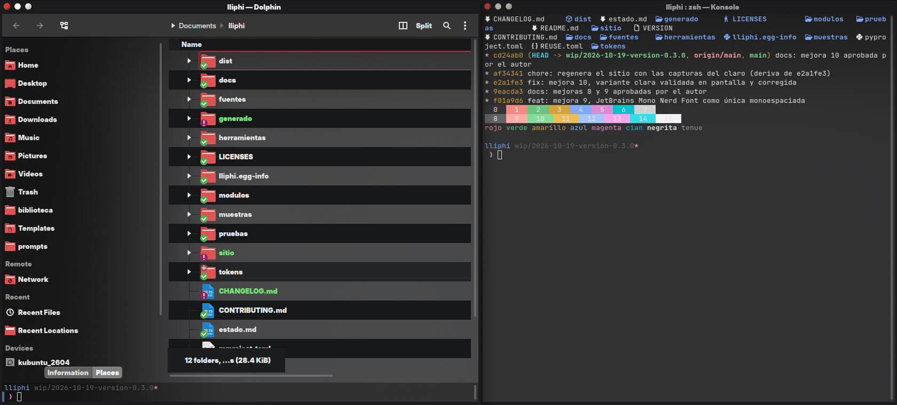
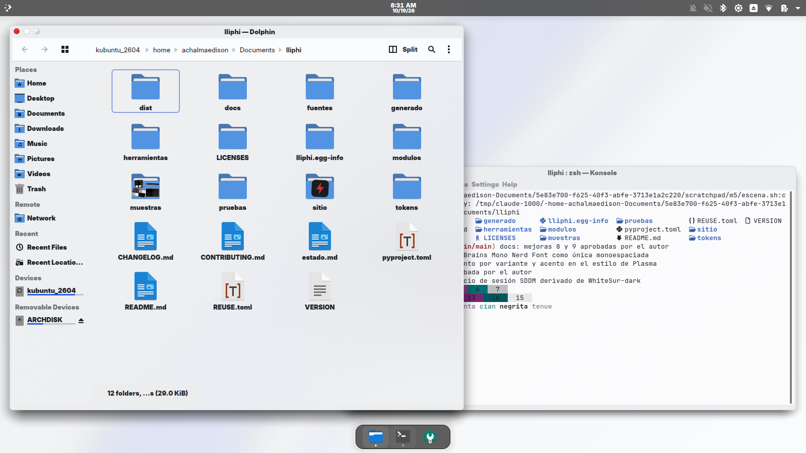

# Lliphi

Ecosistema de temas para KDE Plasma 6 derivado de WhiteSur y Nothing: el oscuro con el rojo de Nothing, el claro con
el azul de WhiteSur, Inter y JetBrains Mono, generado desde una sola fuente de tokens e instalado de forma reversible. Sitio: [achalmed.github.io/lliphi](https://achalmed.github.io/lliphi/).





## Uso

```bash
python3 herramientas/instalar.py                                  # simula: qué respaldaría y copiaría
python3 herramientas/instalar.py dependencias --aplicar           # Papirus, cursores WhiteSur y JetBrains Mono Nerd Font
python3 herramientas/instalar.py --aplicar --aplicar-tema oscuro  # instala en ~/.local/share y aplica el tema
python3 herramientas/instalar.py comprobar                        # todo instalado, de esta versión y reconocido por KDE
python3 herramientas/instalar.py desinstalar --aplicar            # retira lo instalado
bash ~/.local/state/lliphi/respaldos/<fecha>/UNDO.sh              # vuelve exactamente a lo de antes
```

Requiere Plasma 6 (probado en 6.6) y Python ≥ 3.10; nunca pide `sudo`, salvo el inicio de sesión SDDM
(`instalar.py sddm`, con pkexec). Para desarrollar:

```bash
python3 -m venv .venv && .venv/bin/pip install -e ".[dev]"
.venv/bin/python modulos/esquema/paleta.py --aplicar  # tokens/tokens.json y contraste
.venv/bin/python herramientas/generar.py --aplicar    # generado/ y sitio/generado/
.venv/bin/python herramientas/generar.py validar      # módulos, dependencias, estructura KDE e integración
.venv/bin/pytest && .venv/bin/reuse lint              # pruebas y licencias
quarto render sitio                                   # el sitio → sitio/_site
python3 herramientas/sesion.py arrancar --aplicar     # sesión de prueba: Plasma anidado con su propio HOME (cerrar: sesion.py cerrar)
```

**Lliphi Studio** (`studio/`, opcional; QML + Kirigami sobre `gui-comun` 3.0) es el centro de configuración del
tema, por áreas (sistema de diseño, esquemas de color, Plasma, Kvantum, Konsole, editores, fondos, tipografía, iconos,
otros destinos). Muestra:

- la paleta OKLCH con su color real, claro y oscuro lado a lado, y los contrastes WCAG con su veredicto;
- de cada destino, lo instalado frente a lo generado, archivo por archivo.

Generar, instalar y desinstalar van en seis pasos visibles, con el `UNDO.sh` del instalador. Corre estas mismas
órdenes; ver [`studio/README.md`](studio/README.md) y [`docs/reingenieria.md`](docs/reingenieria.md).

```bash
/usr/bin/python3 -m venv --system-site-packages .venv && .venv/bin/pip install -r requirements.txt   # coloraide (paleta.py)
python3 -m pip install --user "gui-comun @ git+https://github.com/achalmed/gui-comun.git@v4.0.0"      # o GUI_COMUN_DIR
/usr/bin/python3 studio/main.py
```

## Arquitectura

Un **tema global** que integra **seis módulos**, más los **complementos** que viven fuera del tema global, y un
**núcleo** común de construcción, validación e instalación que los descubre por su `modulo.json`
([`docs/arquitectura.md`](docs/arquitectura.md)).

| módulo | id | entrega |
|---|---|---|
| Tema global (integrador) | `global` | `org.lliphi.claro`, `org.lliphi.oscuro` (`Plasma/LookAndFeel`) |
| Esquema de color | `esquema` | `LliphiClaro.colors`, `LliphiOscuro.colors`; la paleta |
| Estilo de Plasma | `estilo` | `lliphi-claro`, `lliphi-oscuro` (`Plasma/Theme`) |
| Decoración de ventanas | `decoracion` | `lliphi`, `lliphi-claro` (Aurorae SVG) |
| Iconos y cursores | `iconos-cursores` | Papirus, `Papirus-Dark-Lliphi`, WhiteSur-cursors (terceros, a petición) |
| Carga, salida y bloqueo | `carga-bloqueo` | pantalla de carga y de salida (dentro del tema global); fondo del bloqueo |
| Disposición del escritorio | `disposicion` | paneles y widgets (script dentro del tema global) |
| Complementos | `fondos`, `kvantum`, `konsole`, `terminales`, `editores`, `libreoffice`, `sddm`, `obsidian`, `navegadores`, `telegram`, `sitios-web` | fondo, estilo de aplicaciones, terminales, editores, ofimática, inicio de sesión, tema de Obsidian ([obsidian-lliphi](https://github.com/achalmed/obsidian-lliphi)), Zen Browser y Chrome, Telegram Desktop, DuckDuckGo y GitHub |

## Estructura

| carpeta | qué es |
|---|---|
| `tokens/` | fuente de verdad: `tokens.json` (color en OKLCH, DTCG 2025.10; lo escribe `modulos/esquema/paleta.py`) y `marca.json` |
| `global/` | el tema global: manifiesto, construcción (integra), aplicación y tipografía |
| `modulos/<id>/` | los seis módulos: `modulo.json`, `README.md`, `INSTALL.md`, `construir.py` y, si aplica, `aplicar.py` y `externas.py` |
| `complementos/<id>/` | lo que no es parte del tema global, con el mismo contrato |
| `herramientas/` | `generar.py` (construir, verificar, validar, empaquetar), `instalar.py` (instalar, aplicar, comprobar, desinstalar, dependencias, sddm), `sesion.py` (la sesión de prueba), `nucleo/` y herramientas de muestras |
| `studio/` | Lliphi Studio, la ventana opcional (QML + Kirigami sobre `gui-comun` 3.0): el centro de configuración del tema, y sus pruebas (`studio/tests/run.sh`) |
| `fuentes/base/` | bases de terceros (WhiteSur-kde, Nothing) con su licencia y `ORIGEN.md` |
| `generado/<id>/` | lo que entrega cada módulo, tal como se instala; **no se edita**, `generar.py verificar` lo comprueba |
| `pruebas/` | tokens, contraste, deriva, estructura de paquetes, arquitectura, instalación reversible, REUSE |
| `docs/` | arquitectura, migración modular, entorno, investigación, decisiones, compatibilidad, validación… |
| `muestras/` | láminas, bocetos y `capturas/` reales por variante y caso |
| `sitio/` | el sitio oficial (Quarto); `sitio/generado/` lo escribe `generar.py` |
| `estado.md` | lo primero que se lee y lo último que se escribe en cada sesión de trabajo |

## Límite honesto

Primer lote (0.1.0): esquemas, temas globales, estilo de Plasma, Konsole y fondos; probado en Kubuntu 26.04 con
Plasma 6.6 en Wayland desde una sesión anidada. Segundo lote (sin publicar): terminales (Alacritty, Kitty), editores
(VS Code, Positron, VSCodium, Zed), LibreOffice e iconos de carpeta, generados y probados por estructura, sin
verificación visual en las aplicaciones.
La arquitectura modular (2026-10-31) instala exactamente lo mismo que 0.3.0, comprobado archivo a archivo.
Pendientes: validación con inicio de sesión real (SDDM, bloqueo, escalas), GTK, cursores, navegador, publicación en
KDE Store. Las vistas
previas de los paquetes son capturas reales; los bocetos están rotulados como bocetos.
