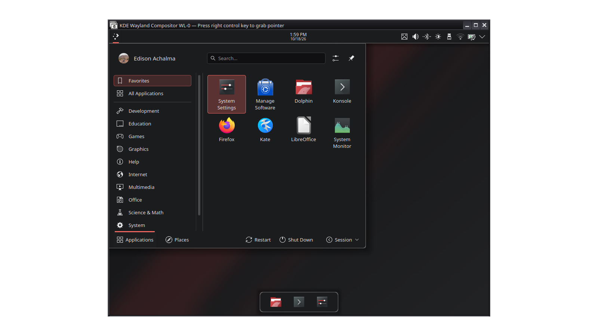

# Lliphi

Ecosistema de temas para KDE Plasma 6: casi negro y gris suave con un solo acento rojo, variantes clara y oscura
generadas desde una sola fuente de tokens, contraste medido e instalación reversible. Sitio: [lliphi.netlify.app](https://lliphi.netlify.app/).



## Uso

```bash
python3 herramientas/instalar.py                                  # simula: qué respaldaría y copiaría
python3 herramientas/instalar.py --aplicar --aplicar-tema oscuro  # instala en ~/.local/share y aplica el tema
python3 herramientas/instalar.py desinstalar --aplicar            # retira lo instalado
bash ~/.local/state/lliphi/respaldos/<fecha>/UNDO.sh              # vuelve exactamente a lo de antes
```

Requiere Plasma 6 (probado en 6.6) y Python ≥ 3.10; nunca pide `sudo`. Para desarrollar:

```bash
python3 -m venv .venv && .venv/bin/pip install -e ".[dev]"
.venv/bin/python herramientas/paleta.py --aplicar     # tokens/tokens.json y contraste
.venv/bin/python herramientas/generar.py --aplicar    # generado/ y sitio/generado/
.venv/bin/pytest && .venv/bin/reuse lint              # pruebas y licencias
quarto render sitio                                   # el sitio → sitio/_site
```

## Estructura

| carpeta | qué es |
|---|---|
| `tokens/` | fuente de verdad: `tokens.json` (color en OKLCH, DTCG 2025.10; lo escribe `paleta.py`) y `marca.json` |
| `herramientas/` | `paleta.py`, `generar.py` + `destinos/` (un generador por componente), `instalar.py`, `lamina.py`, `boceto.py` |
| `generado/` | los módulos tal como se instalan; **no se edita**, `generar.py verificar` lo comprueba |
| `modulos/` | un `modulo.json` + `INSTALL.md` por pieza publicable (de ahí sale el catálogo del sitio) |
| `pruebas/` | tokens, contraste, deriva, estructura de paquetes, instalación reversible, REUSE |
| `docs/` | entorno, investigación, análisis de los temas de partida, nombre, dirección artística, arquitectura, decisiones, compatibilidad, validación |
| `muestras/` | láminas, bocetos y `capturas/` reales por variante y caso |
| `sitio/` | el sitio oficial (Quarto); `sitio/generado/` lo escribe `generar.py` |
| `estado.md` | lo primero que se lee y lo último que se escribe en cada sesión de trabajo |

## Límite honesto

Primer lote (0.1.0): esquemas, temas globales, estilo de Plasma, Konsole y fondos; probado en Kubuntu 26.04 con
Plasma 6.6 en Wayland desde una sesión anidada. Segundo lote (sin publicar): terminales (Alacritty, Kitty), editores
(VS Code, Positron, VSCodium, Zed), LibreOffice e iconos de carpeta, generados y probados por estructura, sin
verificación visual en las aplicaciones.
Pendientes: validación con inicio de sesión real (SDDM, bloqueo, escalas), GTK, cursores, navegador, publicación en
KDE Store. Las vistas
previas de los paquetes son capturas reales; los bocetos están rotulados como bocetos.
