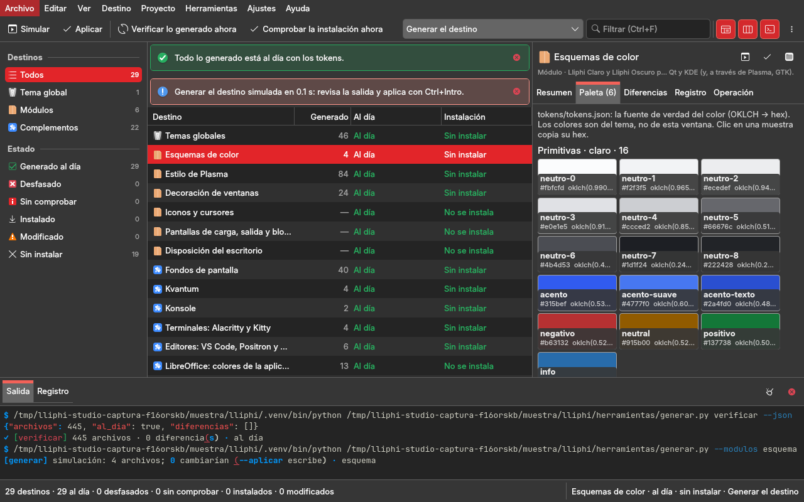
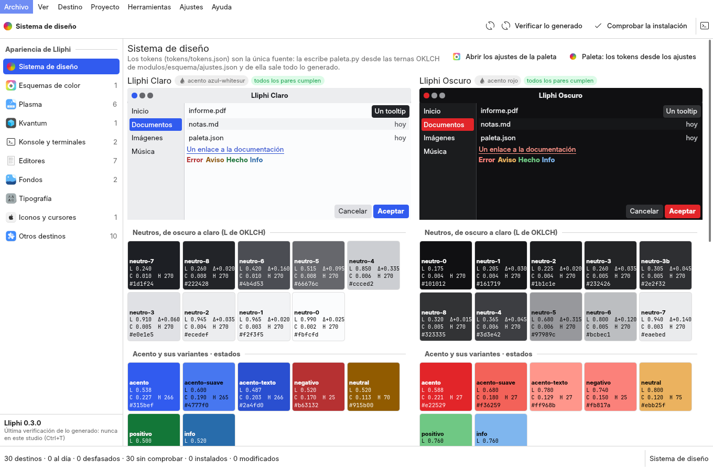
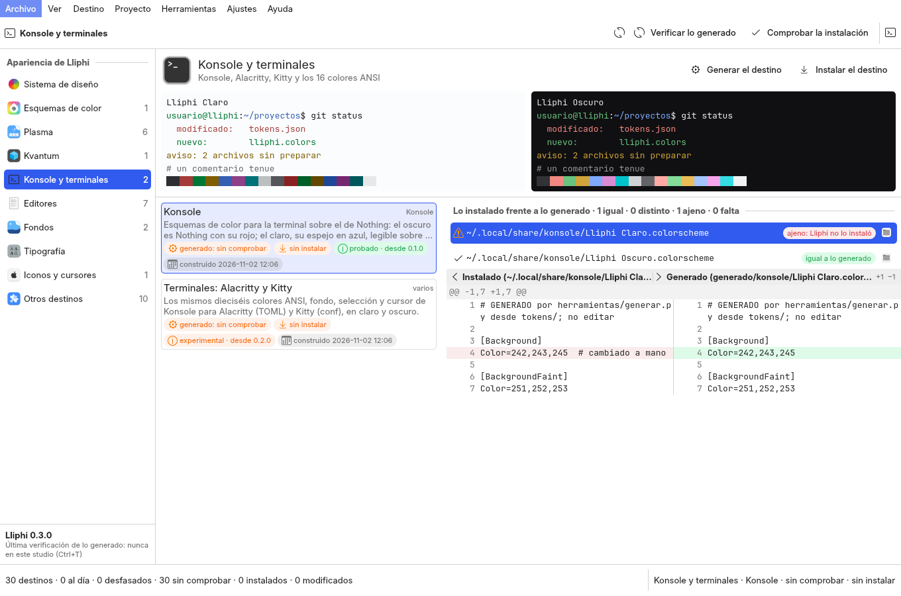
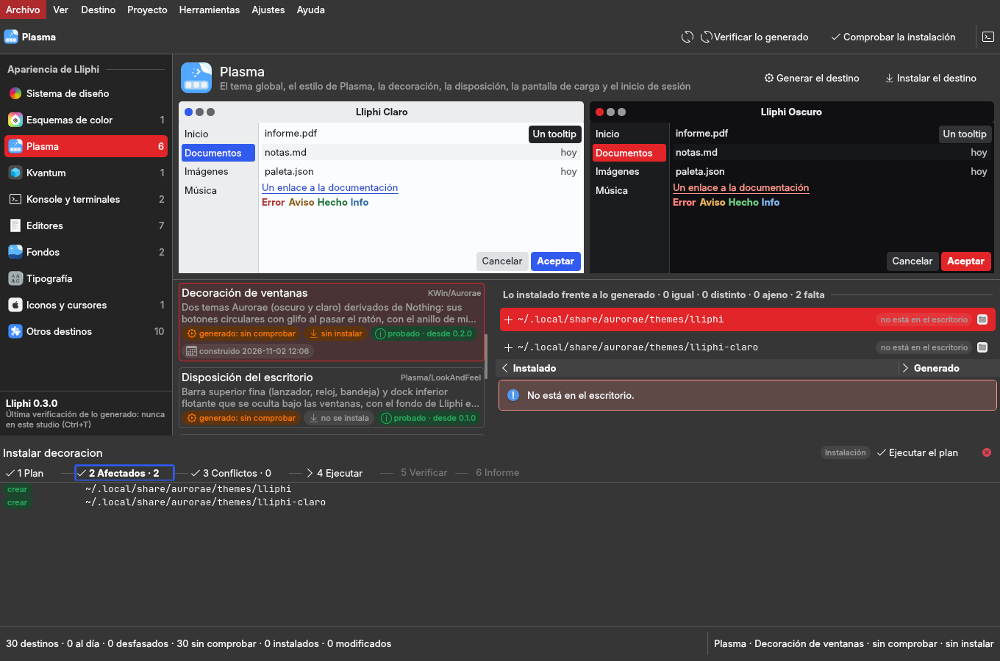
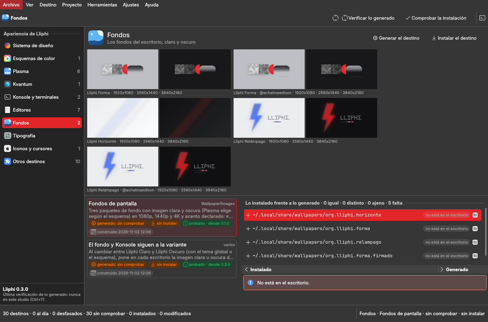
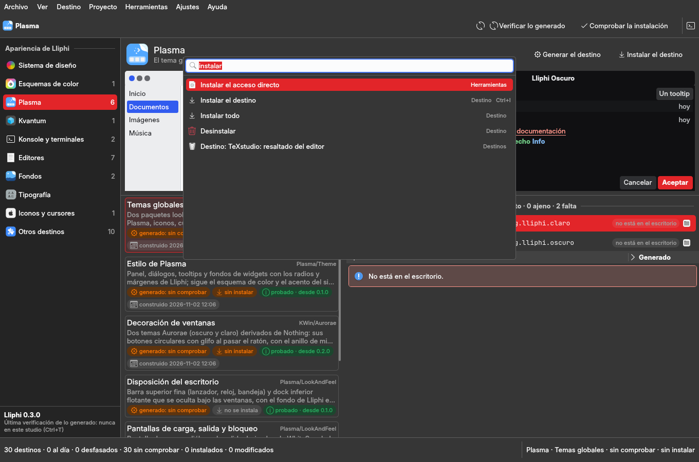

# Reingeniería de Lliphi Studio

Encargo del autor del 2026-11-02: cada studio deja de ser una variación de Dolphin y toma la arquitectura de su
disciplina. Para Lliphi Studio, **un centro de configuración del escritorio**, con Preferencias del sistema de KDE como
referencia. La navegación va por áreas y cada área tiene su página propia: el sistema de diseño, los esquemas de color,
Plasma, Kvantum, Konsole, los editores, los fondos, la tipografía, los iconos y los otros destinos. Cada página
muestra:

- lo instalado frente a lo generado y sus diferencias;
- el estado de instalación, la compatibilidad y la fecha.

La paleta OKLCH se ve con su color real:

- muestras grandes con sus valores OKLCH y hex;
- los contrastes WCAG de los pares que importan, con su veredicto;
- las relaciones (la escala de neutros, el acento y sus variantes);
- una maqueta de ventana pintada con los tokens como datos;
- claro y oscuro lado a lado.

Generar, instalar y desinstalar se hacen en seis pasos visibles. La sesión de prueba anidada es una acción aparte, con
confirmación. Los tokens siguen siendo la única fuente. La base común es `gui-comun` 3.0. El diseño anterior está en
`rediseno.md`; este documento lo sustituye como guía de la ventana.

## 1. Diagnóstico (leído en el código de `respaldo/antes-reingenieria-2026-11-02`)

### 1.1 Visual y de arquitectura de interacción

- **Es Dolphin con datos del tema.** `studio/lliphi_app/qml/Main.qml` es una `VentanaStudio`:
  - a la izquierda, la navegación de filtros por rol y estado;
  - en el centro, una tabla de los ~30 destinos con las columnas Destino, Rol, Clase, Formato, Generado, Al día,
    Instalación y Última construcción;
  - a la derecha, cinco pestañas: Resumen, Paleta, Diferencias, Registro y Operación;
  - abajo, la consola.

  El esquema de color, Konsole, los fondos y la tipografía son la misma fila de tabla con el mismo Resumen en Markdown.
  Nada se ve: un tema de escritorio se juzga mirándolo.
- **La paleta es una lista** (`componentes/Paleta.qml`): una franja de color por token con su nombre y su hex,
  en una pestaña lateral de 24 unidades de ancho, una variante debajo de la otra. No muestra contraste, relaciones ni
  vista previa, y claro y oscuro no se ven a la vez. `servicios/color.py` (OKLCH → sRGB, contraste WCAG, daltonismo,
  usos) existe desde 1.x y la ventana no lo usa.
- **Un solo selector de operación para todo.** Las 21 operaciones del catálogo (`servicios/operaciones.py`) se eligen
  en un combo; F5 y Ctrl+Intro corren la elegida. «Instalar el destino» y «Arrancar la sesión de prueba» se piden
  igual, con el mismo diálogo.

### 1.2 Funcional

- **«Configuración actual frente a generada» no existe por archivo.** «Instalación» dice instalado, modificado o sin
  instalar a partir del manifiesto e `instalar.py estado --json`. No dice qué archivo del escritorio difiere de lo
  generado, ni cuál ocupa una ruta sin haberlo instalado Lliphi (el conflicto `ajeno` del núcleo, que solo se ve cuando
  `instalar.py` sale con 3).
- **Instalar no muestra su plan antes de confirmar.** La confirmación nombra la orden y lo que toca en general
  («copia lo generado a ~/.local/share…»), no la lista de pares origen → destino. Tampoco qué se sobrescribe, qué se
  omite porque su base no existe ni qué es ajeno. Después no hay una verificación aparte del éxito, ni un informe.
- **Desinstalar es una operación más del combo**: no enseña lo que retirará ni lo que queda (las dependencias de
  terceros, el respaldo).
- **Compatibilidad**: el `estado` de cada `modulo.json` (probado, experimental) y `docs/compatibilidad.md` no
  aparecen en la ventana; tampoco las herramientas del sistema que faltan, salvo dentro del Resumen.
- **La sesión de prueba** está en un diálogo de Herramientas junto a las otras operaciones. La confirmación existe
  (S5), pero no dice cuánto pesa ya `~/.cache/lliphi/sesiones`, que en esta máquina pasa de 800 MB.
- **Los editores visuales de 1.x** (color, Plasma, decoración, iconos, pantallas, disposición) se retiraron en la 2.0
  (S6). El autor dejó abierto si vuelven como componentes QML (`estado.md`). Se decide en §3.4.

### 1.3 Usabilidad

- **Los atajos son genéricos**: F5 lee o simula y Ctrl+Intro aplica la operación elegida, sea cual sea.
- **Los errores son la salida de la orden**: el código y «revisa el panel inferior»; no dicen la causa probable ni qué
  hacer (falta el `.venv`, falta `coloraide`, conflicto 3, dependencia 2).
- Para saber si «Al día» está vigente hay que leer «sin comprobar» y pulsar Verificar (Ctrl+T), que tarda unos veinte
  segundos.

### 1.4 Integración con KDE

- **La aplicación es una `QGuiApplication`** (`gui-comun` 2.7): sin el diálogo de archivos de KDE ni el estilo
  pintado con `QStyle`.
- **Dolphin se abre con `xdg-open`** de la carpeta.

### 1.5 Riesgos

- **Instalar escribe en la sesión real del autor.** Las pruebas y las capturas trabajan sobre la copia de
  `studio/muestra.py` con HOME y XDG temporales, y ninguna instala en la sesión real ni abre una sesión anidada.
- **`~/.cache/lliphi/sesiones` ya pesa centenares de MB.** Nada nuevo debe dejar sesiones allí.
- **El repo es público y otras sesiones trabajan en Lliphi** (ramas `claude/*`). Esta reingeniería toca solo
  `studio/` y la documentación, en su worktree.

## 2. Referencias

| referencia | qué se toma |
|---|---|
| Preferencias del sistema de KDE (Colores, Estilo de las aplicaciones, Tema global, Iconos, Fuentes, Fondo) | la barra lateral por áreas y la página propia de cada una, con su vista previa |
| Colores de KDE · selector de esquemas | ver el esquema como una ventana pintada, no como una lista de claves |
| Herramientas de paleta OKLCH (oklch.com, Huetone, Leonardo de Adobe) | muestras grandes, L/C/H y hex, escalas, contraste WCAG con veredicto por par |
| Gestores de temas de Linux (Gradience, Themix) | claro y oscuro a la vez; aplicar con vuelta atrás |
| Filesystem Studio (esta familia) | las escrituras en seis pasos visibles |

## 3. Arquitectura nueva

### 3.1 La ventana

`VentanaBase` con una barra lateral de áreas, como Preferencias del sistema. Cada área es una página:

| área | destinos | lo propio de su página |
|---|---|---|
| Sistema de diseño | los tokens (`tokens/tokens.json`) | la paleta OKLCH con color real, claro y oscuro lado a lado, contrastes WCAG con veredicto, relaciones (neutros, acento y variantes, estados) y la maqueta de una ventana pintada con los tokens |
| Esquemas de color | `esquema` | los dos esquemas como ventana pintada, y lo instalado frente a lo generado |
| Plasma | `global`, `estilo`, `decoracion`, `disposicion`, `carga-bloqueo`, `sddm` | el tema global y sus componentes |
| Kvantum | `kvantum` | controles de muestra con los colores del tema |
| Konsole y terminales | `konsole`, `terminales` | una terminal de muestra con los 16 colores ANSI de cada variante |
| Editores | `editores`, `kate`, `texstudio`, `vim`, `rstudio`, `octave`, `spyder` | un fragmento de código con los colores de sintaxis |
| Fondos | `fondos`, `fondo-variante` | las imágenes generadas, claro y oscuro |
| Tipografía | los tokens de tipografía | las familias en su tamaño, y si están instaladas (`fc-list`) |
| Iconos | `iconos-cursores` | muestras de los iconos generados |
| Otros destinos | los complementos restantes | por destino |

En todas las páginas, cada destino lleva su tarjeta de estado:

- lo generado (al día, desfasado, sin comprobar) y la fecha de su construcción;
- la instalación;
- la compatibilidad: el `estado` del `modulo.json`, «desde» y las herramientas que faltan;
- **lo instalado frente a lo generado, archivo por archivo**: igual, distinto, falta o ajeno (un archivo que Lliphi no
  instaló), con la diferencia del archivo elegido.

### 3.2 Escribir en seis pasos

Generar, instalar y desinstalar un destino (o todo) se hacen en seis pasos visibles:

1. **plan**: qué orden y por qué;
2. **afectados**: cada par origen → destino con su acción (crear, reemplazar, igual, retirar);
3. **conflictos**: lo ajeno, que bloquea, y lo omitido porque su base no está;
4. **ejecutar**: tras confirmar; instalar y desinstalar son operaciones de **instalación** y **eliminación** de
   `gui-comun` 3.0, con su respaldo y su `UNDO.sh`;
5. **verificar**: aparte del éxito; relee el estado y comprueba la suma de cada ruta;
6. **informe**: en Markdown, guardado en la caché del studio.

El plan lo calcula el núcleo de Lliphi (`herramientas/nucleo/instalacion.py`: `pares_de`, `ajeno`, el manifiesto), no
una copia: la ventana lo carga por ruta.

### 3.3 La sesión de prueba

La sesión de prueba es una acción propia del menú Herramientas, con confirmación (estado de operación «escritura»). Sus
consecuencias se calculan al pedirla:

- arranca KWin y Plasma anidados;
- deja una casa nueva;
- dice cuánto pesa ya la caché de sesiones.

Las pruebas comprueban que ninguna orden la arranca sin esa confirmación.

### 3.4 Decisión: los editores visuales de 1.x no vuelven como editores

Los tokens son la única fuente, y `modulos/esquema/paleta.py` es quien los escribe desde `ajustes.json`. Un editor
visual en la ventana sería una segunda vía para el mismo dato. En 1.x esa vía se escribía a mano por módulo, era
frágil y no se usaba (S6).

Lo que el autor necesita al decidir un color es **verlo**, y eso sí entra: la página del sistema de diseño enseña cada
token con su color, su contraste y la maqueta, en las dos variantes a la vez. Desde ella, «Abrir los ajustes» abre el
`ajustes.json` del esquema en su editor, y «Paleta» simula `paleta.py`: F5 dice qué cambiaría en `tokens.json`, y
Ctrl+Intro lo escribe tras confirmar. El resultado se ve en la misma página.

Si el autor quiere editar dentro de la ventana, el camino es un componente QML sobre `servicios/color.py`, que escriba el
borrador de `proyecto.guardar_borrador`. Queda anotado en `estado.md`.

## 4. El resultado

Capturas sobre la copia de `studio/muestra.py` (HOME y XDG temporales, ninguna ruta de la máquina), hechas con
`studio/capturar.py`; `--pasos` solo prepara el plan.

| antes (2.0) | ahora (3.0) |
|---|---|
| una tabla de ~30 destinos y cinco pestañas laterales | diez áreas en la barra lateral, cada una con su página y su vista previa |
| la paleta, una lista de franjas en una pestaña | claro y oscuro lado a lado: maqueta, escalas con L, C, H y ΔL, acento y variantes, estados, ANSI y contrastes WCAG con su veredicto |
| la instalación, una palabra por destino | lo instalado frente a lo generado, archivo por archivo (igual · distinto · ajeno · falta), con su diferencia lado a lado |
| la compatibilidad, solo en el Resumen | en la tarjeta: el `estado` del `modulo.json`, «desde», lo que falta, la fecha de construcción |
| instalar: la orden y un texto general | seis pasos: el plan del núcleo, cada ruta afectada, lo ajeno que bloquea, ejecutar con su estado de operación, verificar aparte e informe |
| un combo para las 21 operaciones; F5 y Ctrl+Intro para todo | Ctrl+B generar, Ctrl+I instalar, Ctrl+Intro ejecutar el plan, Ctrl+T verificar, Ctrl+1…0 las áreas; las demás órdenes en Proyecto y Herramientas |
| la sesión de prueba, en un diálogo | una acción propia con confirmación que dice cuánto pesan ya las sesiones |
| `QGuiApplication`; Dolphin con `xdg-open` | `QApplication` (`gui-comun` 3.0); Dolphin con la ruta señalada y abrir con su aplicación |

Pruebas: 38 en `studio/tests/run.sh` y las 86 del proyecto (`pruebas/`), en verde. Instalar y desinstalar `konsole` se
prueban de verdad en el HOME de la copia, igual que un archivo ajeno que bloquea. Ninguna prueba instala en la sesión
real ni abre una sesión anidada. REUSE conforme.

## 5. Lo que queda fuera

- `sddm` y `gtk-root` siguen en la terminal: piden pkexec (S7).
- La publicación en la KDE Store, el empaquetado y el sitio siguen como operaciones de Proyecto, sin página propia.
