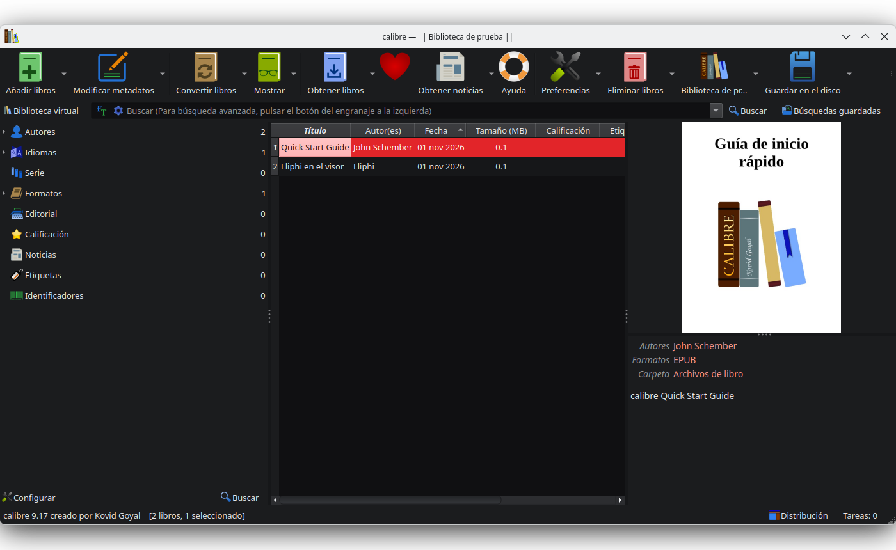
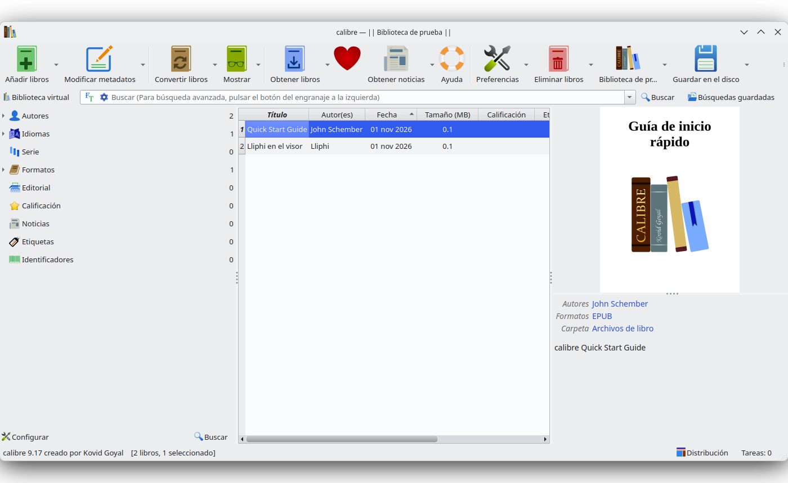
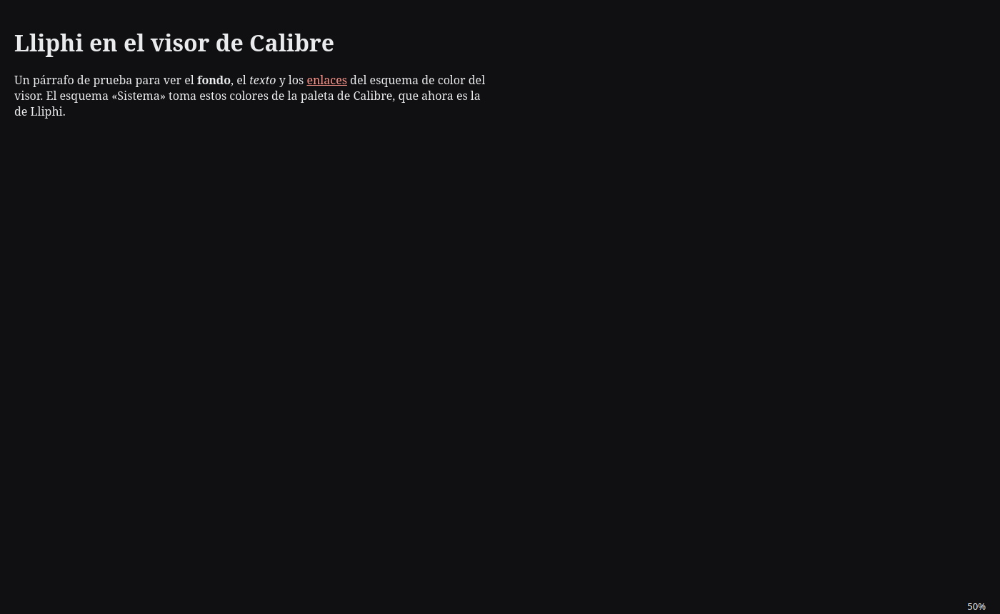
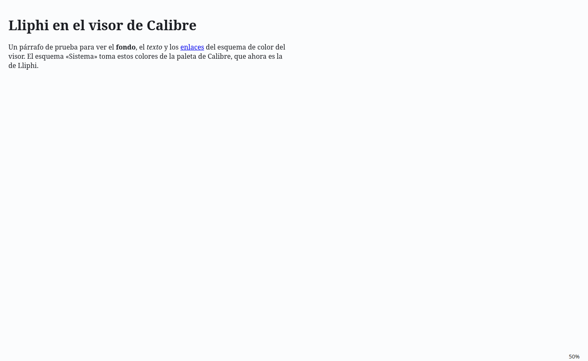

| | |
|---|---|
| papel | complemento (paquete) |
| estado | **probado** |
| tecnología | `gui.json` de Calibre ≥ 7 (`color_palette`, `light_palettes`, `dark_palettes`: rol de `QPalette` → color) · `viewer-webengine.json` (`session_data.user_color_schemes`) · fundido con Calibre cerrado |
| desde la versión | 0.4.0 |
| archivos | `gui-lliphi.json`, `visor-lliphi.json` |
| licencia | MIT |






## Instalar

Calibre guarda sus colores en sus preferencias, no en una carpeta de temas: no hay archivos que copiar. Con el
instalador, **con Calibre y su visor cerrados**:

```bash
python3 herramientas/instalar.py --modulos calibre --aplicar --aplicar-tema oscuro
```

Respalda `~/.config/calibre/gui.json` y `viewer-webengine.json` (en `UNDO.sh`) y funde en ellos las paletas y los
esquemas del visor. Si Calibre está abierto, no toca nada. Si usas `CALIBRE_CONFIG_DIRECTORY` fuera de `~/.config`,
hazlo a mano.

A mano, con Calibre cerrado y una copia de los dos archivos:

1. En `~/.config/calibre/gui.json`, añade las claves de `gui-lliphi.json` (salvo `_nota`); si ya tienes paletas propias
   en `light_palettes` o `dark_palettes`, añade la de Lliphi junto a ellas.
2. En `~/.config/calibre/viewer-webengine.json`, dentro de `session_data`, añade a `user_color_schemes` los dos
   esquemas de `visor-lliphi.json`.
3. Abre Calibre: Preferencias → Aspecto y comportamiento → Interfaz principal → «Paleta de colores: del sistema». En el
   visor, Preferencias → Colores: «Sistema» sigue al escritorio; «Lliphi Claro» y «Lliphi Oscuro» quedan fijos.

## Actualizar

Vuelve a aplicar con Calibre cerrado: se sustituyen las paletas y los esquemas de Lliphi, no se duplican.

## Desinstalar

`UNDO.sh` devuelve los dos archivos tal como estaban. A mano: en Preferencias, elige otra paleta para cada modo, y en
el visor borra los esquemas de Lliphi.


## Código, incidencias y cambios

- Código: [`complementos/calibre/`](https://github.com/achalmed/lliphi/tree/main/complementos/calibre) (manifiesto, fuente y su `README.md`); lo generado, en [`generado/calibre`](https://github.com/achalmed/lliphi/tree/main/generado/calibre).
- Incidencias: [https://github.com/achalmed/lliphi/issues](https://github.com/achalmed/lliphi/issues?q=label%3Acalibre).
- Cambios: [registro de cambios](../../cambios.qmd).
