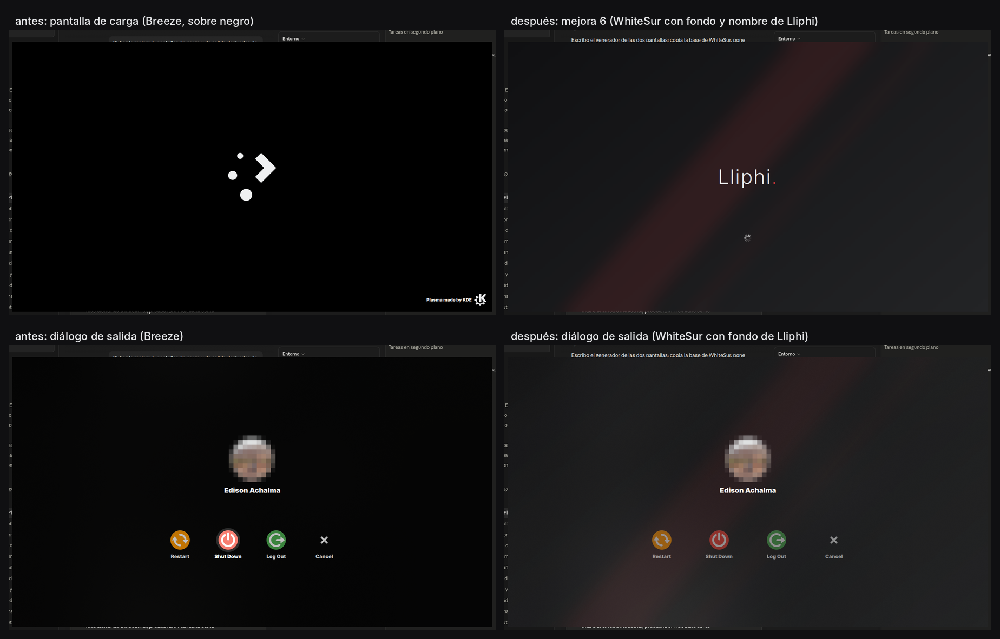

| | |
|---|---|
| papel | módulo (componente) |
| estado | **probado** |
| tecnología | `contents/splash/` y `contents/logout/` del tema global (QML de WhiteSur-dark, GPL-3.0) · fondo del bloqueo en `kscreenlockerrc` (el QML del bloqueo es del paquete de shell en Plasma 6.6) |
| desde la versión | 0.3.0 |
| archivos | `contents/splash/`, `contents/logout/` |
| licencia | GPL-3.0-or-later |



## Instalar

No se instala por separado: la pantalla de carga y el diálogo de salida van **dentro del tema global**
(`contents/splash/` y `contents/logout/` de `org.lliphi.claro` y `org.lliphi.oscuro`), porque Plasma solo los carga de
ahí. Se instalan con el tema global y se eligen con él (`[KSplash] Theme`). Para verla sin cerrar la sesión:

```bash
ksplashqml org.lliphi.oscuro --test --window   # con el tema global ya instalado (decisiones 4.10)
```

**Bloqueo de pantalla**: en Plasma 6.6 su interfaz es la del paquete de shell de Plasma, no la de un tema global; lo
que Lliphi le da es el fondo oscuro de Lliphi en las dos variantes (para que el reloj blanco se lea también en el
claro). Lo escribe `instalar.py --aplicar --aplicar-tema …` en `kscreenlockerrc`, con respaldo; a mano: Preferencias
del sistema → Pantalla de bloqueo → Fondo.

El **inicio de sesión (SDDM)** es otra cosa: es el complemento `sddm`, con su propia orden.

## Actualizar

Se actualiza con el tema global.

## Desinstalar

Se retira con el tema global; `UNDO.sh` devuelve `kscreenlockerrc` a como estaba. A mano: Preferencias del sistema →
Arranque y apagado → Pantalla de presentación.


## Código, incidencias y cambios

- Código: [`modulos/carga-bloqueo/`](https://github.com/achalmed/lliphi/tree/main/modulos/carga-bloqueo) (manifiesto, fuente y su `README.md`); lo generado, en [`generado/global`](https://github.com/achalmed/lliphi/tree/main/generado/global).
- Incidencias: [https://github.com/achalmed/lliphi/issues](https://github.com/achalmed/lliphi/issues?q=label%3Acarga-bloqueo).
- Cambios: [registro de cambios](../../cambios.qmd).
