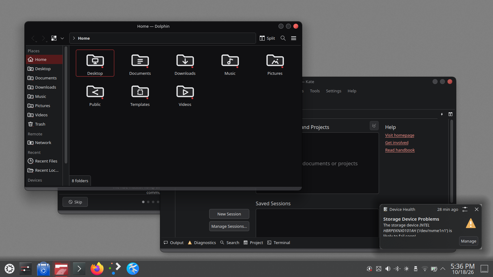
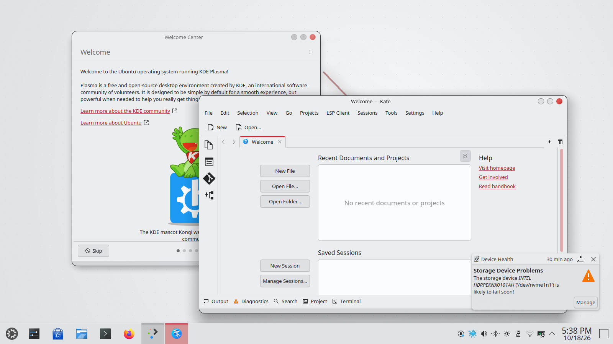

| | |
|---|---|
| estado | **probado** |
| tecnología | Aurorae SVG (motor V2 de Plasma 6.6, `kwin-style-aurorae`); derivado de WhiteSur-dark y Nothing, GPL-3.0-or-later |
| desde la versión | 0.2.0 |
| archivos | `lliphi/`, `lliphi-claro/` |
| licencia | GPL-3.0-or-later |




Requiere Plasma 6.6 o posterior con el motor Aurorae (`kwin-style-aurorae` en Kubuntu; en 6.6 Aurorae se dividió en
V1, solo QML, y V2, el motor SVG que lee estos temas; el KCM los registra con `library=org.kde.kwin.aurorae.v2`).

## Instalar a mano

1. Copia `lliphi/` y `lliphi-claro/` a `~/.local/share/aurorae/themes/`.
2. Preferencias del sistema → Apariencia y estilo → Colores y temas → Decoración de ventanas → elige **Lliphi** (con la
   variante oscura) o **Lliphi Claro** (con la clara). También: `kcmshell6 kcm_kwindecoration`.

Sin la interfaz:

```bash
kwriteconfig6 --file kwinrc --group org.kde.kdecoration2 --key library org.kde.kwin.aurorae.v2
kwriteconfig6 --file kwinrc --group org.kde.kdecoration2 --key theme __aurorae__svg__lliphi      # o __aurorae__svg__lliphi-claro
kwriteconfig6 --file kwinrc --group org.kde.kdecoration2 --key ButtonsOnLeft ""
kwriteconfig6 --file kwinrc --group org.kde.kdecoration2 --key ButtonsOnRight IAX
qdbus6 org.kde.KWin /KWin reconfigure
```

Los temas globales `org.lliphi.oscuro` y `org.lliphi.claro` ya traen estas claves en sus `defaults`: al aplicar el tema
global con el instalador (`--aplicar-tema`) o con `plasma-apply-lookandfeel -a` la decoración se activa sola.

## Actualizar

Sustituye las dos carpetas y vuelve a elegir el tema (o cambia a otro y vuelve): KWin no relee los SVG de un tema ya
cargado solo con `reconfigure`.

## Desinstalar

Elige otra decoración (Brisa) en Preferencias del sistema y borra `~/.local/share/aurorae/themes/lliphi` y
`~/.local/share/aurorae/themes/lliphi-claro`. El instalador (`desinstalar`) hace lo segundo; `UNDO.sh` restaura además el
`kwinrc` previo.


## Código, incidencias y cambios

- Código: [`generado/aurorae`](https://github.com/achalmed/lliphi/tree/main/generado/aurorae) y su generador
  [`herramientas/destinos/aurorae.py`](https://github.com/achalmed/lliphi/blob/main/herramientas/destinos/aurorae.py).
- Incidencias: [https://github.com/achalmed/lliphi/issues](https://github.com/achalmed/lliphi/issues?q=label%3Adecoracion).
- Cambios: [registro de cambios](../../cambios.qmd).
