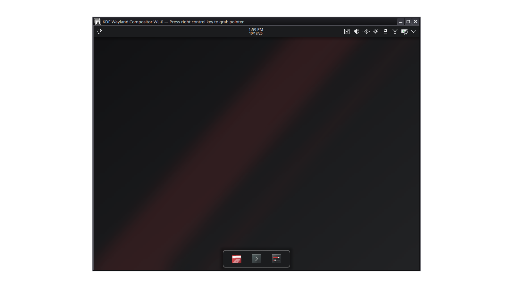

| | |
|---|---|
| papel | módulo (componente) |
| estado | **probado** |
| tecnología | script de disposición de Plasma (`contents/layouts/org.kde.plasma.desktop-layout.js`, API de scripting de escritorio) dentro del tema global |
| desde la versión | 0.1.0 |
| archivos | `contents/layouts/org.kde.plasma.desktop-layout.js` |
| licencia | MIT |

## Instalar

No se instala por separado: el script de disposición va **dentro del tema global**
(`contents/layouts/org.kde.plasma.desktop-layout.js`), que es de donde Plasma lo lee. Se aplica solo si lo pides:

- en Preferencias del sistema → Apariencia y estilo → Tema global, marcando «Disposición del escritorio»; o
- con `plasma-apply-lookandfeel -a org.lliphi.oscuro --resetLayout`.

**Sustituye tu disposición actual** (paneles y widgets). El instalador del proyecto respalda antes
`plasma-org.kde.plasma.desktop-appletsrc` y las notas del widget de notas (`~/.local/share/plasma_notes`), que Plasma
borra si el widget desaparece; `UNDO.sh` las devuelve.

## Actualizar

Se actualiza con el tema global; la disposición nueva solo se ve si vuelves a aplicarla.

## Desinstalar

Ejecuta el `UNDO.sh` del respaldo (restaura `plasma-org.kde.plasma.desktop-appletsrc`) y cierra la sesión.

## Código, incidencias y cambios

- Código: [`modulos/disposicion/`](https://github.com/achalmed/lliphi/tree/main/modulos/disposicion) (manifiesto, fuente y su `README.md`); lo generado, en [`generado/global`](https://github.com/achalmed/lliphi/tree/main/generado/global).
- Incidencias: [https://github.com/achalmed/lliphi/issues](https://github.com/achalmed/lliphi/issues?q=label%3Adisposicion).
- Cambios: [registro de cambios](../../cambios.qmd).
