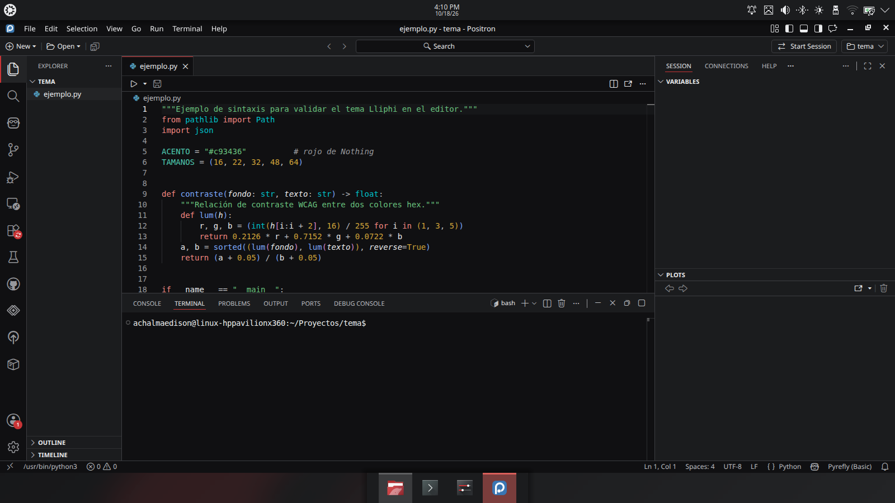
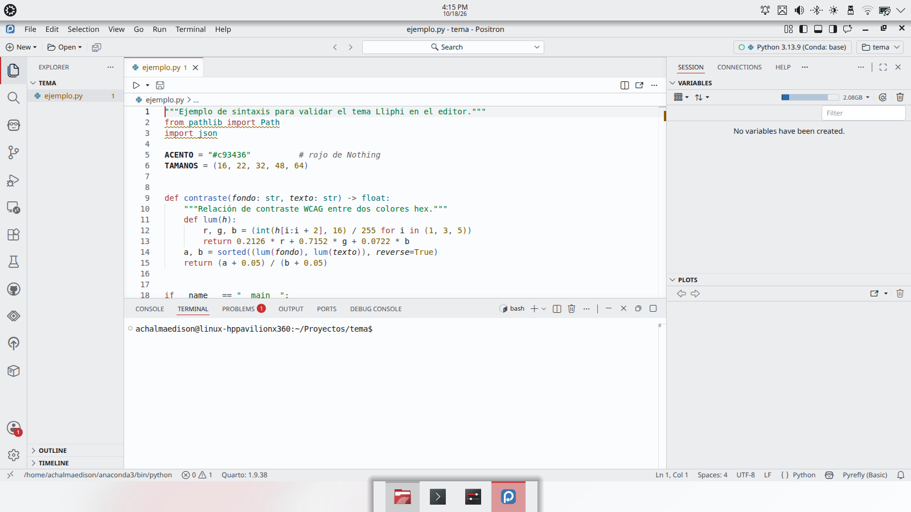
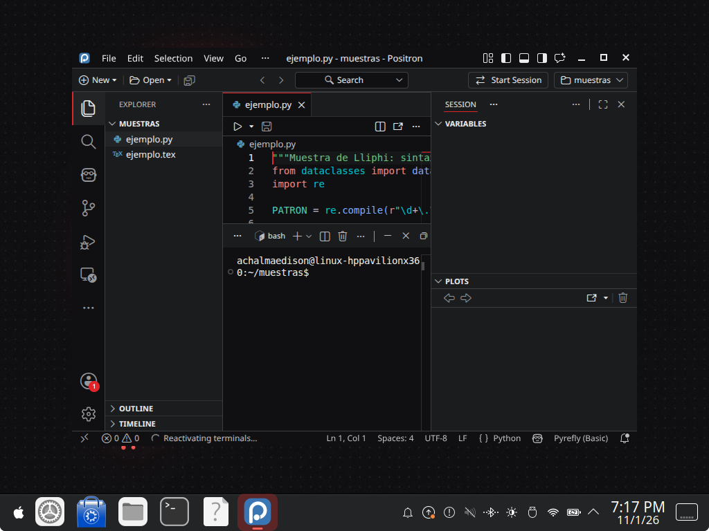
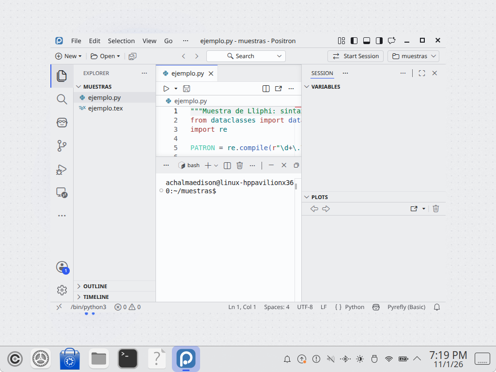

| | |
|---|---|
| papel | complemento (paquete) |
| estado | **experimental** |
| tecnología | VS Code color theme (`colors`, `tokenColors`, `semanticTokenColors`), empaquetado como `.vsix` e instalado con `--install-extension` de VS Code, Positron y VSCodium · Zed theme v0.2.0 |
| desde la versión | 0.2.0 |
| archivos | `vscode/lliphi/`, `vscode/lliphi.vsix`, `zed/lliphi.json` |
| licencia | CC-BY-SA-4.0 |






## Instalar

El instalador (`python3 herramientas/instalar.py --modulos editores --aplicar`) instala la extensión con la orden de
cada editor de la familia que esté en el PATH (`code`, `positron`, `codium`): `<editor> --install-extension
generado/editores/vscode/lliphi.vsix --force`, que la registra en su `extensions.json` (con `--extensions-dir` si está
definida `$VSCODE_EXTENSIONS`, `$POSITRON_EXTENSIONS` o `$VSCODIUM_EXTENSIONS`). Copia además el tema de Zed a
`~/.config/zed/themes/lliphi.json`. El `UNDO.sh` y `instalar.py desinstalar` la retiran con `--uninstall-extension`.
Ningún editor activa el tema solo.

**No copies la carpeta `vscode/lliphi/` a `~/.<editor>/extensions/`**: las versiones actuales solo cargan las
extensiones de su registro, anotan la carpeta copiada en `.obsolete` como desinstalada y no muestran los temas
(decisiones 5.9). A mano, instala el `.vsix`:

```bash
positron --install-extension generado/editores/vscode/lliphi.vsix --force    # o code, o codium
```

o, dentro del editor, Extensiones → «…» → Instalar desde VSIX. Recarga la ventana si estaba abierto.

### VS Code

1. Instala `vscode/lliphi.vsix` (arriba).
2. Elige el tema: `Ctrl+K Ctrl+T` → «Lliphi Oscuro» o «Lliphi Claro»; o en `settings.json`:

```json
"workbench.colorTheme": "Lliphi Oscuro"
```

Para que siga al sistema: `"window.autoDetectColorScheme": true`, `"workbench.preferredDarkColorTheme": "Lliphi Oscuro"`,
`"workbench.preferredLightColorTheme": "Lliphi Claro"`.

### Positron y VSCodium

Positron (Posit) y VSCodium son derivados de VS Code y leen la misma extensión. Instala `vscode/lliphi.vsix` con su
orden (`positron` o `codium`, arriba) y elige el tema como en VS Code (`Ctrl+K Ctrl+T` o `workbench.colorTheme`).
Positron guarda su `settings.json` en `~/.config/Positron/User/`; VSCodium, en `~/.config/VSCodium/User/`.

En Positron el tema cubre también lo que es solo suyo (decisiones 5.4): la consola (con el fondo y los ANSI de la
terminal integrada), las barras de acciones de cada panel, los diálogos, el explorador de datos y la cuadrícula de
variables, los gráficos del resumen de columnas, el estado del intérprete y la bienvenida. Para que siga a la variante
de Plasma, como en VS Code (`settings.json` de Positron):

```json
"window.autoDetectColorScheme": true,
"workbench.preferredDarkColorTheme": "Lliphi Oscuro",
"workbench.preferredLightColorTheme": "Lliphi Claro"
```

### Zed

1. Copia `zed/lliphi.json` a `~/.config/zed/themes/`.
2. En Zed: paleta de órdenes → `theme selector: toggle` → «Lliphi Oscuro» o «Lliphi Claro»; o en `settings.json`:

```json
"theme": { "mode": "system", "dark": "Lliphi Oscuro", "light": "Lliphi Claro" }
```

Zed relee la carpeta de temas al vuelo.

## Actualizar

Sustituye la carpeta de la extensión y el archivo de Zed; los nombres de los temas no cambian.

## Desinstalar

Elige otro tema en cada editor, `<editor> --uninstall-extension lliphi.lliphi` y borra `~/.config/zed/themes/lliphi.json`.
El instalador (`desinstalar`) hace lo segundo y no toca los `settings.json`, que son tuyos.


## Código, incidencias y cambios

- Código: [`complementos/editores/`](https://github.com/achalmed/lliphi/tree/main/complementos/editores) (manifiesto, fuente y su `README.md`); lo generado, en [`generado/editores`](https://github.com/achalmed/lliphi/tree/main/generado/editores).
- Incidencias: [https://github.com/achalmed/lliphi/issues](https://github.com/achalmed/lliphi/issues?q=label%3Aeditores).
- Cambios: [registro de cambios](../../cambios.qmd).
