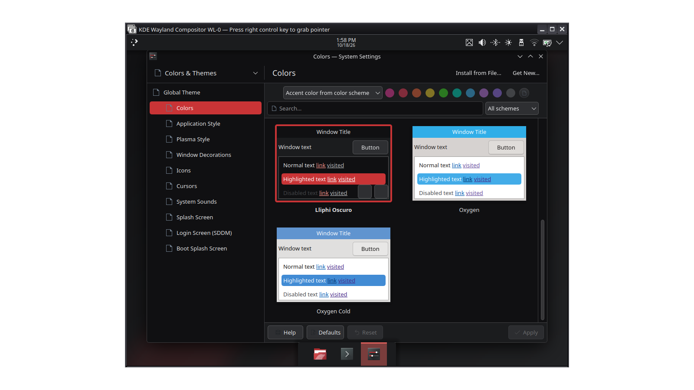
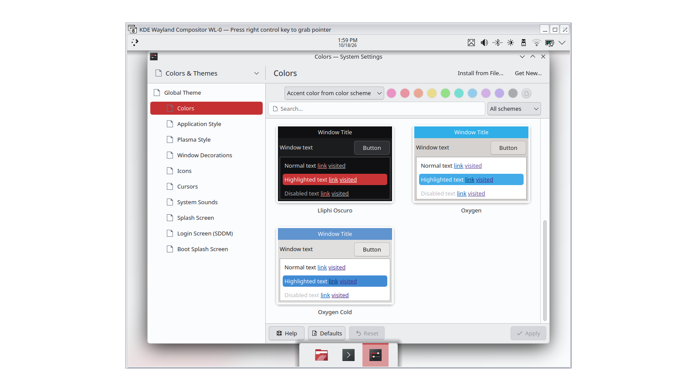

| | |
|---|---|
| papel | módulo (paquete) |
| estado | **probado** |
| tecnología | KColorScheme (`.colors`) |
| desde la versión | 0.1.0 |
| archivos | `LliphiClaro.colors`, `LliphiOscuro.colors` |
| licencia | CC-BY-SA-4.0 |




## Instalar a mano

1. Copia `LliphiClaro.colors` y `LliphiOscuro.colors` a `~/.local/share/color-schemes/` (crea la carpeta si no existe).
2. Preferencias del sistema → Apariencia y estilo → Colores → elige «Lliphi Claro» o «Lliphi Oscuro»; o en un terminal:

```bash
plasma-apply-colorscheme LliphiOscuro
```

## Actualizar

Sustituye los dos archivos por los de la versión nueva y vuelve a aplicar el esquema (Plasma no relee un esquema ya aplicado hasta que lo aplicas otra vez).

## Desinstalar

Elige otro esquema en Preferencias y borra los dos archivos de `~/.local/share/color-schemes/`.


## Código, incidencias y cambios

- Código: [`modulos/esquema/`](https://github.com/achalmed/lliphi/tree/main/modulos/esquema) (manifiesto, fuente y su `README.md`); lo generado, en [`generado/esquema`](https://github.com/achalmed/lliphi/tree/main/generado/esquema).
- Incidencias: [https://github.com/achalmed/lliphi/issues](https://github.com/achalmed/lliphi/issues?q=label%3Aesquema).
- Cambios: [registro de cambios](../../cambios.qmd).
