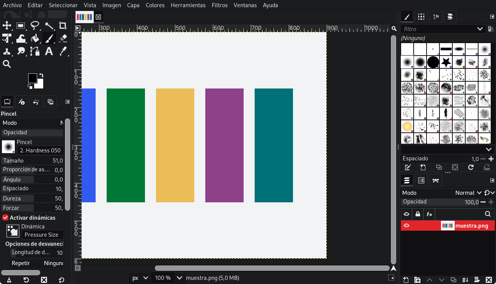
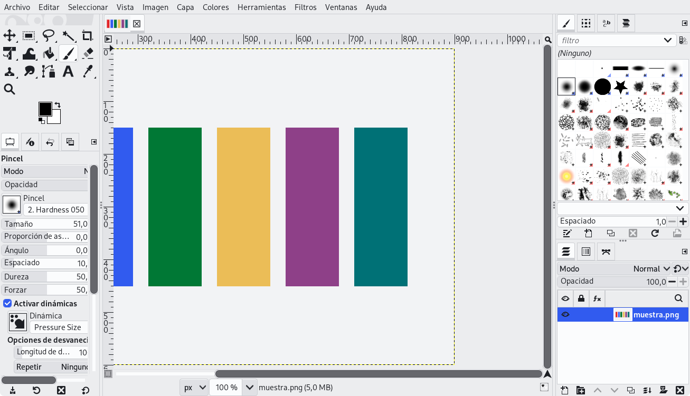

| | |
|---|---|
| papel | complemento (paquete) |
| estado | **probado** |
| tecnología | tema de GIMP 3 (`gimp-{light,gray,dark}.css` con 17 `@define-color` e importación de `common-*.css`, CSS de GTK 3) · `(theme-color-scheme system)` de `gimprc` · paleta «GIMP Palette» (`.gpl`) |
| desde la versión | 0.4.0 |
| archivos | `themes/Lliphi/gimp-light.css`, `themes/Lliphi/gimp-gray.css`, `themes/Lliphi/gimp-dark.css`, `themes/Lliphi/common.css`, `themes/Lliphi/system.css`, `themes/Lliphi/ui/`, `palettes/Lliphi Claro.gpl`, `palettes/Lliphi Oscuro.gpl` |
| licencia | GPL-3.0-or-later |




## Instalar

Con el instalador (simula sin `--aplicar`):

```bash
python3 herramientas/instalar.py --modulos gimp --aplicar --aplicar-tema oscuro
```

Copia el tema a `~/.config/GIMP/3.2/themes/Lliphi/` y las paletas a `~/.config/GIMP/3.2/palettes/`, respalda `gimprc`
y, si GIMP está cerrado, le pone el tema y el esquema «Sistema». Si GIMP está abierto, no toca `gimprc`: elige tú el
tema (abajo).

A mano:

1. Copia `themes/Lliphi/` a `~/.config/GIMP/3.2/themes/` y los dos `.gpl` a `~/.config/GIMP/3.2/palettes/` (en otra
   versión de GIMP 3, cambia `3.2` por la tuya).
2. En GIMP: Editar → Preferencias → Interfaz → Tema → **Lliphi**, y en «Esquema de color», **Sistema** (sigue a
   Plasma) o Claro / Oscuro. El cambio es inmediato.
3. Las paletas aparecen en Ventanas → Diálogos empotrables → Paletas.

## Actualizar

Vuelve a instalar; GIMP relee el tema al elegirlo de nuevo o al arrancar.

## Desinstalar

Elige otro tema en Preferencias, o `UNDO.sh` (devuelve `gimprc`), y borra `themes/Lliphi/` y las dos paletas.


## Código, incidencias y cambios

- Código: [`complementos/gimp/`](https://github.com/achalmed/lliphi/tree/main/complementos/gimp) (manifiesto, fuente y su `README.md`); lo generado, en [`generado/gimp`](https://github.com/achalmed/lliphi/tree/main/generado/gimp).
- Incidencias: [https://github.com/achalmed/lliphi/issues](https://github.com/achalmed/lliphi/issues?q=label%3Agimp).
- Cambios: [registro de cambios](../../cambios.qmd).
