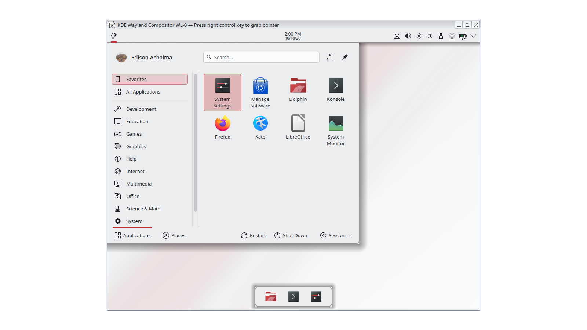

| | |
|---|---|
| estado | **probado** |
| tecnología | KPackage `Plasma/LookAndFeel` |
| desde la versión | 0.1.0 |
| archivos | `org.lliphi.claro/`, `org.lliphi.oscuro/` |
| licencia | CC-BY-SA-4.0 |




## Instalar a mano

```bash
kpackagetool6 -t Plasma/LookAndFeel -i org.lliphi.oscuro
kpackagetool6 -t Plasma/LookAndFeel -i org.lliphi.claro
plasma-apply-lookandfeel -a org.lliphi.oscuro          # añade --resetLayout para la disposición (borra la actual)
```

O en Preferencias del sistema → Apariencia y estilo → Tema global: marca «Disposición del escritorio» solo si quieres el panel superior y el dock de Lliphi (sustituye tu disposición actual; el instalador del proyecto respalda `plasma-org.kde.plasma.desktop-appletsrc` antes).

## Actualizar

```bash
kpackagetool6 -t Plasma/LookAndFeel -u org.lliphi.oscuro
```

## Desinstalar

```bash
plasma-apply-lookandfeel -a org.kde.breeze.desktop     # vuelve a Breeze (o al tema que uses)
kpackagetool6 -t Plasma/LookAndFeel -r org.lliphi.oscuro
kpackagetool6 -t Plasma/LookAndFeel -r org.lliphi.claro
```

El tema global **no instala** los esquemas, el estilo ni el fondo por sí solo: los declara. Instálalos con el instalador del proyecto o módulo a módulo.


## Código, incidencias y cambios

- Código: [`generado/look-and-feel`](https://github.com/achalmed/lliphi/tree/main/generado/look-and-feel) y su generador
  [`herramientas/destinos/lookandfeel.py`](https://github.com/achalmed/lliphi/blob/main/herramientas/destinos/lookandfeel.py).
- Incidencias: [https://github.com/achalmed/lliphi/issues](https://github.com/achalmed/lliphi/issues?q=label%3Aglobal).
- Cambios: [registro de cambios](../../cambios.qmd).
