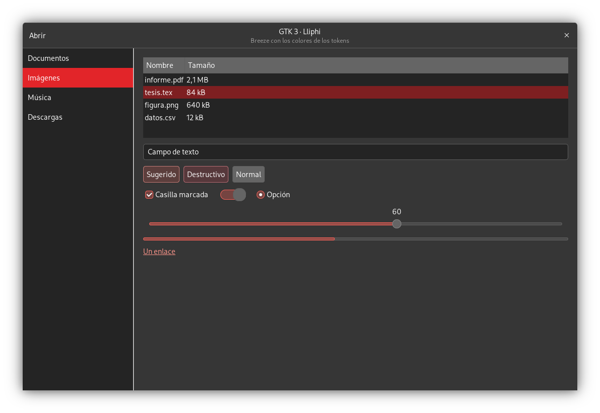
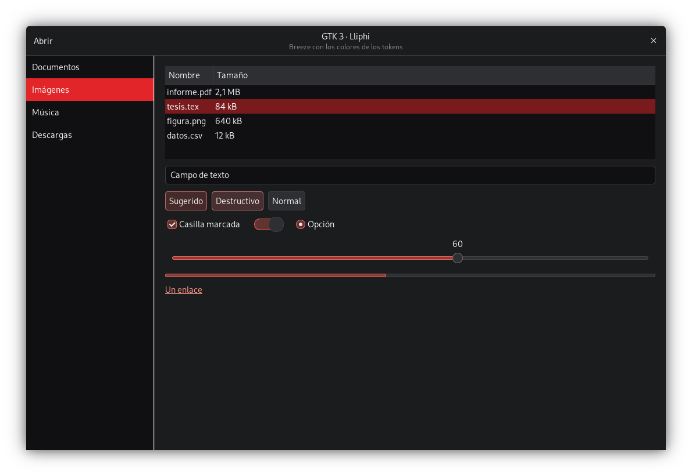
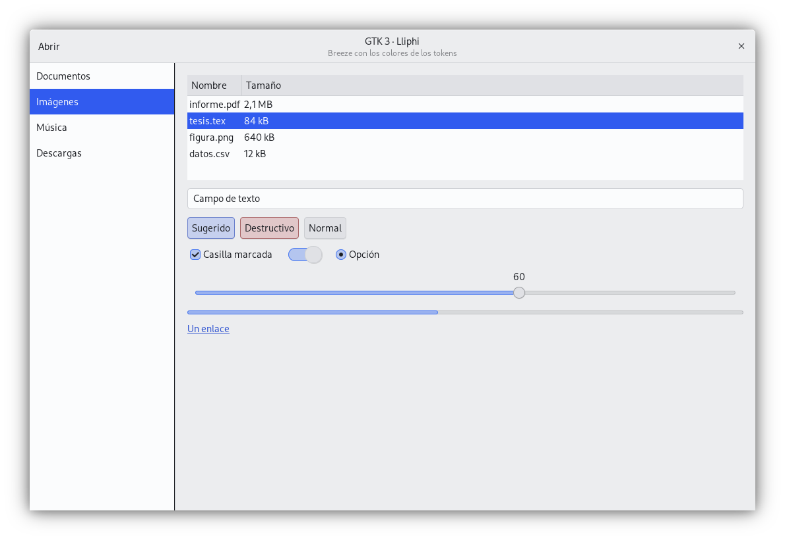
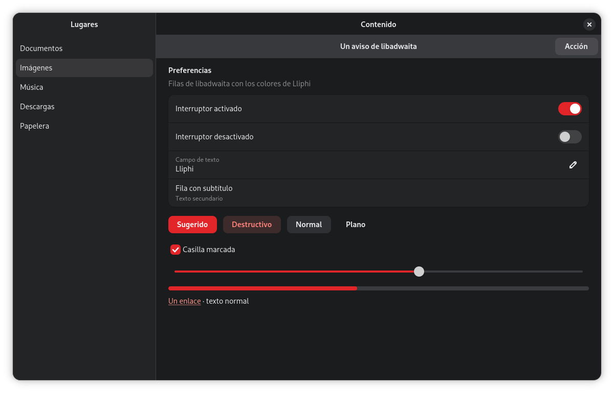
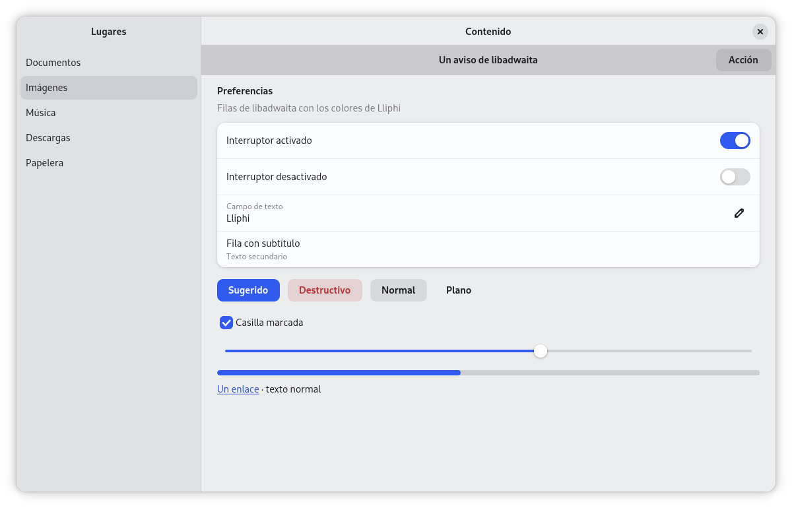

| | |
|---|---|
| papel | complemento (paquete) |
| estado | **probado** |
| tecnología | CSS de GTK (`@define-color` de Breeze `*_breeze` y de libadwaita 1.9, variables `--accent-bg-color`…, `@media (prefers-color-scheme: dark)` de GTK ≥ 4.20) importado desde `~/.config/gtk-{3,4}.0/gtk.css` después del `colors.css` de kde-gtk-config |
| desde la versión | 0.4.0 |
| archivos | `gtk-3.0/lliphi-claro.css`, `gtk-3.0/lliphi-oscuro.css`, `gtk-4.0/lliphi.css` |
| licencia | MIT |







## Instalar

Con el instalador (simula sin `--aplicar`):

```bash
python3 herramientas/instalar.py --modulos gtk --aplicar --aplicar-tema oscuro     # o claro
```

Copia las hojas a `~/.config/gtk-3.0/` y `~/.config/gtk-4.0/`, respalda los dos `gtk.css` (en `UNDO.sh`), les añade la
línea de Lliphi detrás de `@import 'colors.css';` y pone `color-scheme` en GSettings. Para que GTK 3 cambie de hoja con
la variante, instala también `fondo-variante`.

A mano:

1. Copia `gtk-3.0/lliphi-claro.css` y `gtk-3.0/lliphi-oscuro.css` a `~/.config/gtk-3.0/`, y `gtk-4.0/lliphi.css` a
   `~/.config/gtk-4.0/`.
2. En `~/.config/gtk-3.0/gtk.css`, después de `@import 'colors.css';`, añade `@import 'lliphi-oscuro.css';` (o
   `lliphi-claro.css`). En `~/.config/gtk-4.0/gtk.css`, después de `@import 'colors.css';`, añade `@import 'lliphi.css';`.
3. Cierra y vuelve a abrir las aplicaciones GTK.

Si no usas `fondo-variante`, al cambiar de variante cambia a mano la línea de GTK 3 (GTK 4 no lo necesita).

## Actualizar

Vuelve a instalar: las hojas se sustituyen y la línea de `gtk.css` no se duplica.

## Desinstalar

`bash ~/.local/state/lliphi/respaldos/<fecha>/UNDO.sh` devuelve los `gtk.css` y retira las hojas. A mano: borra las
dos líneas `@import 'lliphi…'` y los tres archivos. `color-scheme` no lo devuelve `UNDO.sh`:

```bash
gsettings reset org.gnome.desktop.interface color-scheme
```


## Código, incidencias y cambios

- Código: [`complementos/gtk/`](https://github.com/achalmed/lliphi/tree/main/complementos/gtk) (manifiesto, fuente y su `README.md`); lo generado, en [`generado/gtk`](https://github.com/achalmed/lliphi/tree/main/generado/gtk).
- Incidencias: [https://github.com/achalmed/lliphi/issues](https://github.com/achalmed/lliphi/issues?q=label%3Agtk).
- Cambios: [registro de cambios](../../cambios.qmd).
