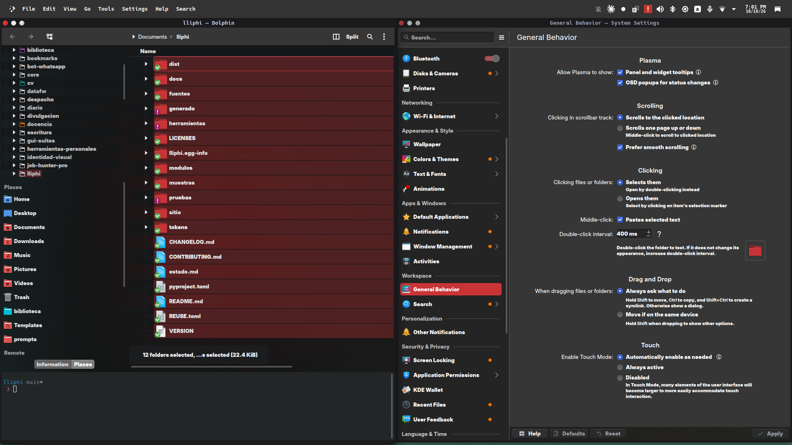

| | |
|---|---|
| papel | módulo (externo) |
| estado | **probado** |
| tecnología | temas de iconos y de cursores freedesktop (`index.theme`, `Inherits`, `cursors/`) en `~/.local/share/icons/` |
| desde la versión | 0.3.0 |
| archivos | — |
| licencia | GPL-3.0 (Colloid, Papirus, WhiteSur-cursors y Bibata; no se redistribuyen) |



## Instalar

Iconos y cursores son de terceros: Lliphi no los redistribuye, los descarga al usuario (sin root) y el tema global los
nombra.

```bash
python3 herramientas/instalar.py dependencias            # simula: qué descargaría
python3 herramientas/instalar.py dependencias --aplicar  # Papirus, Papirus-Dark-Lliphi, WhiteSur-cursors y JetBrains Mono Nerd Font
python3 herramientas/instalar.py dependencias --aplicar --opcionales   # además los cursores Bibata
```

- **Iconos**: Papirus tal como se publica (carpetas azules, variante clara) y el superpuesto `Papirus-Dark-Lliphi`,
  que hereda de Papirus-Dark y solo cambia las carpetas al rojo (variante oscura). Se instalan en
  `~/.local/share/icons/`. Con `--aplicar-tema`, el instalador los aplica; si faltan, usa Papirus-Dark y después Breeze.
- **Cursores**: WhiteSur-cursors en `~/.local/share/icons/WhiteSur-cursors/`; el tema global los declara en
  `[kcminputrc][Mouse]`.

A mano: Preferencias del sistema → Colores y temas → Iconos (o Cursores).

## Actualizar

Borra la carpeta del tema en `~/.local/share/icons/` y vuelve a ejecutar `dependencias --aplicar`.

## Desinstalar

`instalar.py desinstalar` no retira lo de terceros. Elige otro tema de iconos y de cursores y borra
`~/.local/share/icons/{Papirus,Papirus-Dark,Papirus-Light,Papirus-Dark-Lliphi,WhiteSur-cursors}`.


## Código, incidencias y cambios

- Código: [`modulos/iconos-cursores/`](https://github.com/achalmed/lliphi/tree/main/modulos/iconos-cursores) (manifiesto, fuente y su `README.md`).
- Incidencias: [https://github.com/achalmed/lliphi/issues](https://github.com/achalmed/lliphi/issues?q=label%3Aiconos-cursores).
- Cambios: [registro de cambios](../../cambios.qmd).
