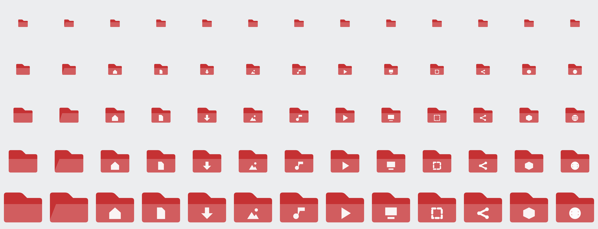

| | |
|---|---|
| estado | **probado** |
| tecnología | freedesktop Icon Theme (`index.theme`, `FollowsColorScheme`, SVG con `current-color-scheme`) |
| desde la versión | 0.2.0 |
| archivos | `lliphi/`, `lliphi-oscuro/` |
| licencia | CC-BY-SA-4.0 |

La imagen de arriba es un render de los SVG (Inkscape) a 16, 22, 32, 48 y 64 px, no una captura del escritorio.

## Instalar a mano

1. Copia `lliphi/` y `lliphi-oscuro/` a `~/.local/share/icons/`.
2. Preferencias del sistema → Apariencia y estilo → Iconos → elige **Lliphi** (con la variante clara) o **Lliphi Oscuro**
   (con la oscura). También: `kcmshell6 kcm_icons`.

Las dos variantes solo se diferencian en lo que heredan (`breeze` o `breeze-dark`), que es lo que ven las aplicaciones
GTK; en las aplicaciones KDE las carpetas toman el color de acento del esquema activo (`FollowsColorScheme`). Todo lo
que no es una carpeta sigue siendo Breeze.

## Actualizar

Sustituye las dos carpetas. Si Plasma no refresca los iconos, cierra la sesión y vuelve a entrar.

## Desinstalar

Elige otro tema de iconos en Preferencias del sistema y borra `~/.local/share/icons/lliphi` y
`~/.local/share/icons/lliphi-oscuro`. El instalador (`desinstalar`) hace lo segundo.

## Código, incidencias y cambios

- Código: [`generado/icons`](https://github.com/achalmed/lliphi/tree/main/generado/icons) y su generador
  [`herramientas/destinos/iconos.py`](https://github.com/achalmed/lliphi/blob/main/herramientas/destinos/iconos.py).
- Incidencias: [https://github.com/achalmed/lliphi/issues](https://github.com/achalmed/lliphi/issues?q=label%3Aiconos).
- Cambios: [registro de cambios](../../cambios.qmd).
