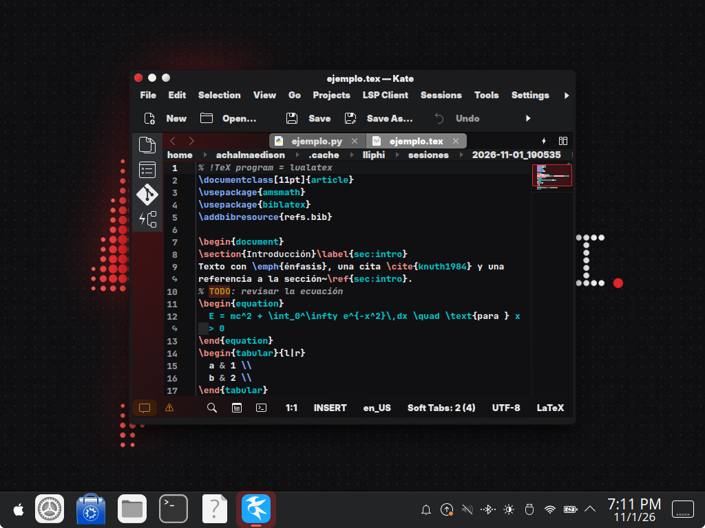
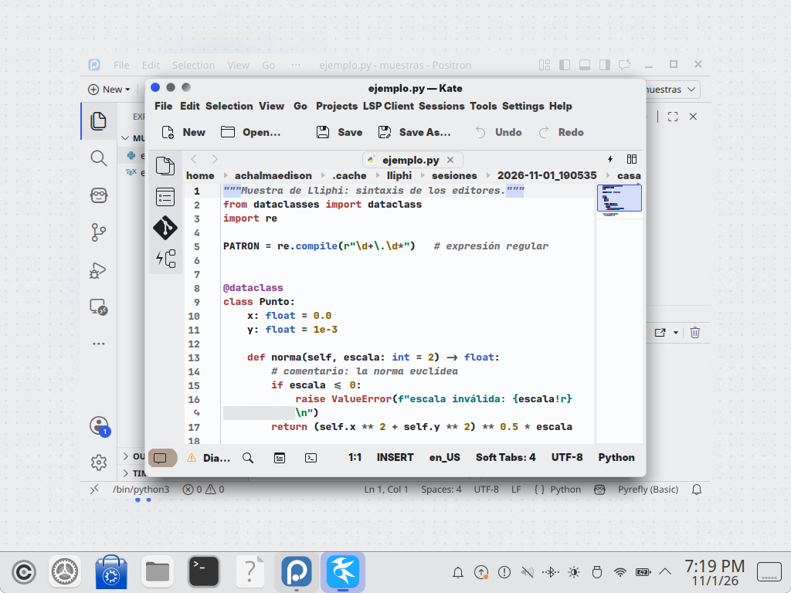

| | |
|---|---|
| papel | complemento (paquete) |
| estado | **probado** |
| tecnología | tema de KSyntaxHighlighting 6 (JSON: `metadata`, `text-styles`, `editor-colors`) en `$XDG_DATA_HOME/org.kde.syntax-highlighting/themes/`; elección automática por la paleta (`Repository::themeForPalette`) |
| desde la versión | 0.4.0 |
| archivos | `lliphi-claro.theme`, `lliphi-oscuro.theme` |
| licencia | CC-BY-SA-4.0 |




## Instalar

```bash
python3 herramientas/instalar.py --modulos kate --aplicar
```

O a mano: copia `generado/kate/lliphi-claro.theme` y `lliphi-oscuro.theme` a
`~/.local/share/org.kde.syntax-highlighting/themes/`.

Después, en Kate: Configuración → Configurar Kate → Apariencia → Temas de color. Hay dos maneras de usarlo:

- **Que siga a la variante (recomendado)**: marca «Seleccionar automáticamente el tema de color» (en `katerc`,
  `[KTextEditor Renderer] Auto Color Theme Selection=true`, el valor por omisión). Con Lliphi Claro o Lliphi Oscuro
  aplicados y el estilo Kvantum (el que pone el tema global), Kate elige el tema de Lliphi de la variante y lo cambia
  al cambiar de variante. Con el estilo Breeze la paleta es otra y Kate cae en Breeze: usa la segunda manera.
- **Uno fijo**: desmarca esa casilla y elige «Lliphi Oscuro» o «Lliphi Claro» en la lista.

Kate lee los temas al arrancar: ciérralo y ábrelo después de instalar.

## Actualizar

Vuelve a instalar; Kate toma el tema de `revision` mayor al arrancar.

## Desinstalar

`python3 herramientas/instalar.py desinstalar --aplicar` (retira lo de todos los módulos) o borra los dos `.theme`; Kate
vuelve a Breeze.


## Código, incidencias y cambios

- Código: [`complementos/kate/`](https://github.com/achalmed/lliphi/tree/main/complementos/kate) (manifiesto, fuente y su `README.md`); lo generado, en [`generado/kate`](https://github.com/achalmed/lliphi/tree/main/generado/kate).
- Incidencias: [https://github.com/achalmed/lliphi/issues](https://github.com/achalmed/lliphi/issues?q=label%3Akate).
- Cambios: [registro de cambios](../../cambios.qmd).
