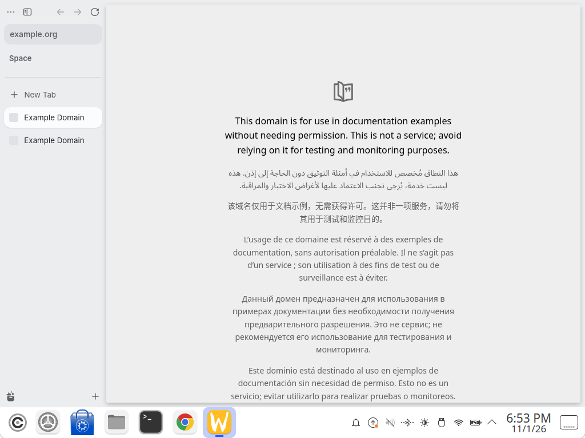
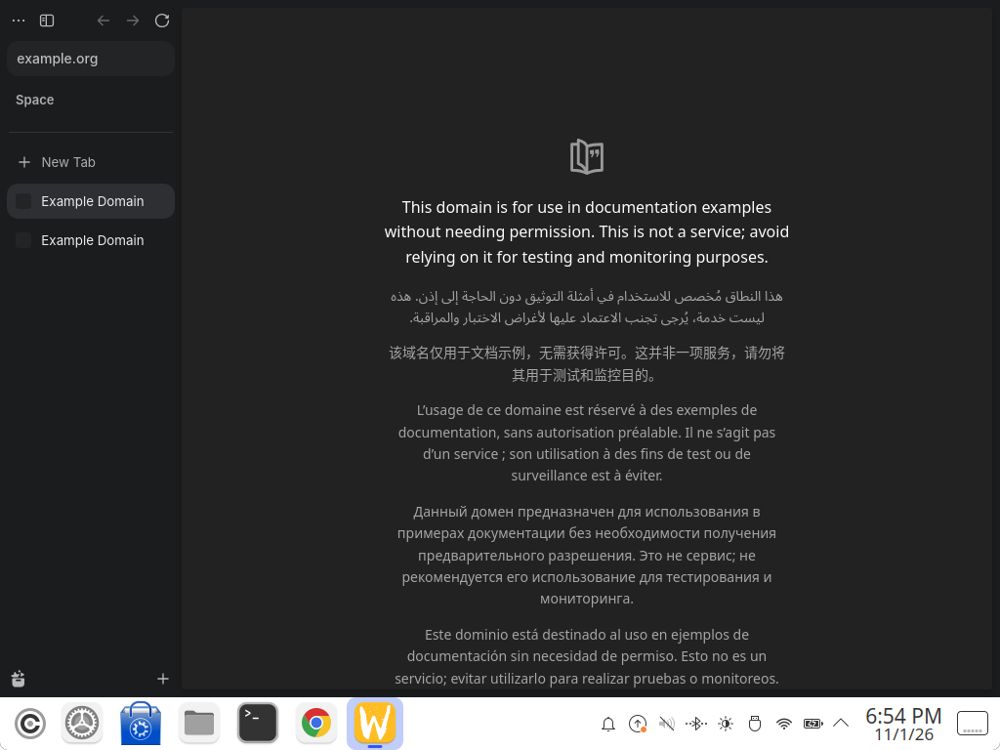
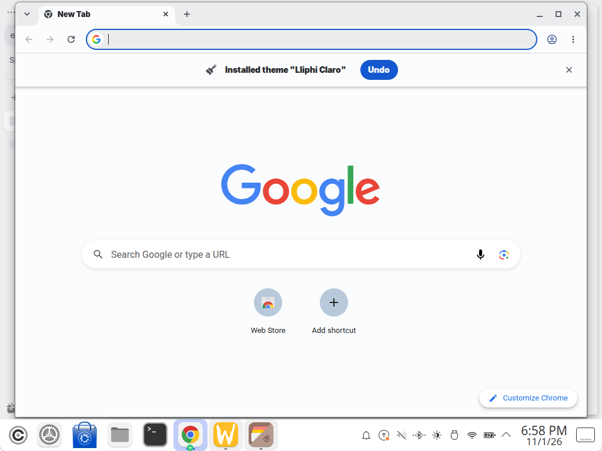
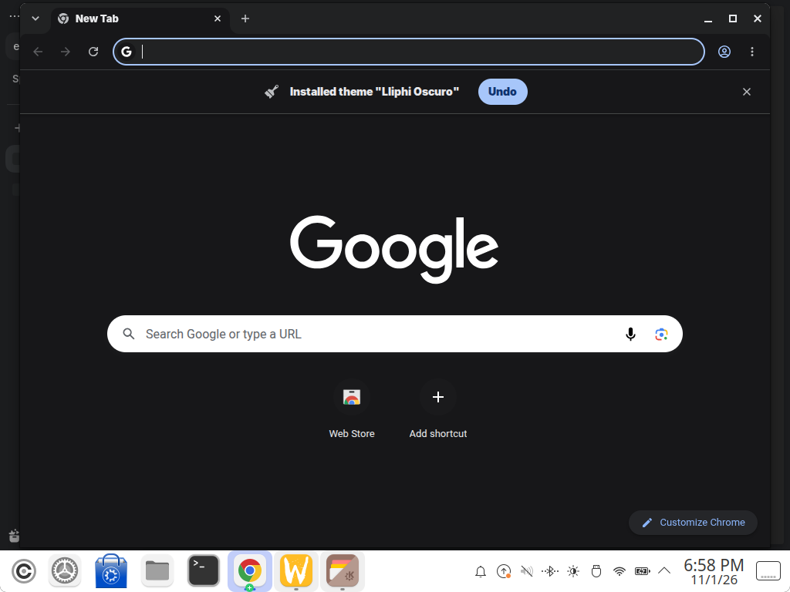

| | |
|---|---|
| papel | complemento (paquete) |
| estado | **experimental** |
| tecnología | Zen Browser ≥ 1.24 (Firefox 159): `userChrome.css` sobre las variables `--zen-*` y de Firefox con `prefers-color-scheme`, y `user.js` (`toolkit.legacyUserProfileCustomizations.stylesheets`, `zen.view.window.scheme = 2`) en el perfil, también el del Flatpak `app.zen_browser.zen` · Chrome ≥ 120: tema de extensión (`manifest.json` v3 con `theme.colors`) sin empaquetar |
| desde la versión | 0.4.0 |
| archivos | `zen/userChrome.css`, `zen/user.js`, `chrome/lliphi-claro/manifest.json`, `chrome/lliphi-oscuro/manifest.json` |
| licencia | CC-BY-SA-4.0 |






## Instalar

### Zen Browser

Requiere Zen 1.24 o posterior (probado en 1.24b, Flatpak `app.zen_browser.zen`, Firefox 159).

```bash
.venv/bin/python herramientas/instalar.py --modulos navegadores            # simula: dice qué perfil usará
.venv/bin/python herramientas/instalar.py --modulos navegadores --aplicar
```

Copia `chrome/userChrome.css` y `user.js` al perfil predeterminado de Zen (el que abre: `installs.ini`). Para otro
perfil, `ZEN_PERFIL=<carpeta del perfil>` delante de la orden. Si el perfil ya tiene un `userChrome.css` o un
`user.js` tuyo, el instalador **no los pisa** y se detiene: añade a mano el contenido de
`generado/navegadores/zen/` a los tuyos.

Después, **cierra Zen del todo y ábrelo**: `user.js` y `userChrome.css` se leen al arrancar. Desde entonces Zen sigue
el modo del sistema: Lliphi Claro con el esquema claro y Lliphi Oscuro con el oscuro, sin reiniciar.

`user.js` pone `zen.view.window.scheme = 2` (el modo del sistema). Si lo tenías en oscuro fijo (0) o claro fijo (1),
Zen lo guarda en `prefs.js`: desinstalar no lo devuelve. Para volver, Ajustes de Zen → Apariencia.

### Google Chrome

Chrome no deja instalar un tema sin empaquetar desde fuera: el instalador deja los dos temas en
`~/.local/share/lliphi/chrome/` y el resto es a mano.

1. Abre `chrome://extensions` y activa el **Modo de desarrollador** (arriba a la derecha).
2. **Cargar descomprimida** → elige `~/.local/share/lliphi/chrome/lliphi-oscuro` (o `lliphi-claro`).
3. Chrome aplica el tema al momento. Para cambiar de variante, carga la otra carpeta del mismo modo: Chrome tiene un
   solo tema activo y no sigue al sistema con un tema puesto.

Si prefieres que Chrome siga solo al sistema, no cargues ningún tema y elige en Personalizar Chrome → Modo
«Dispositivo»: verás los grises de Chrome, no los de Lliphi.

## Actualizar

Vuelve a ejecutar el instalador con `--aplicar`. Zen toma los cambios al reiniciar. En Chrome, `chrome://extensions`
→ el tema de Lliphi → **Volver a cargar** (el icono de la flecha circular).

## Desinstalar

- Todo lo instalado: `.venv/bin/python herramientas/instalar.py desinstalar --aplicar`, o el `UNDO.sh` del último
  respaldo (retira `userChrome.css`, `user.js` y los temas de Chrome).
- Zen: reinicia; vuelve a su aspecto (y al modo de `prefs.js`, ver arriba).
- Chrome: `chrome://settings/appearance` → Tema → **Restablecer al predeterminado**, y quita la extensión en
  `chrome://extensions`.


## Código, incidencias y cambios

- Código: [`complementos/navegadores/`](https://github.com/achalmed/lliphi/tree/main/complementos/navegadores) (manifiesto, fuente y su `README.md`); lo generado, en [`generado/navegadores`](https://github.com/achalmed/lliphi/tree/main/generado/navegadores).
- Incidencias: [https://github.com/achalmed/lliphi/issues](https://github.com/achalmed/lliphi/issues?q=label%3Anavegadores).
- Cambios: [registro de cambios](../../cambios.qmd).
