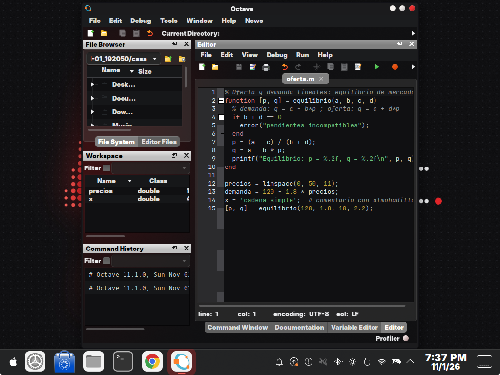
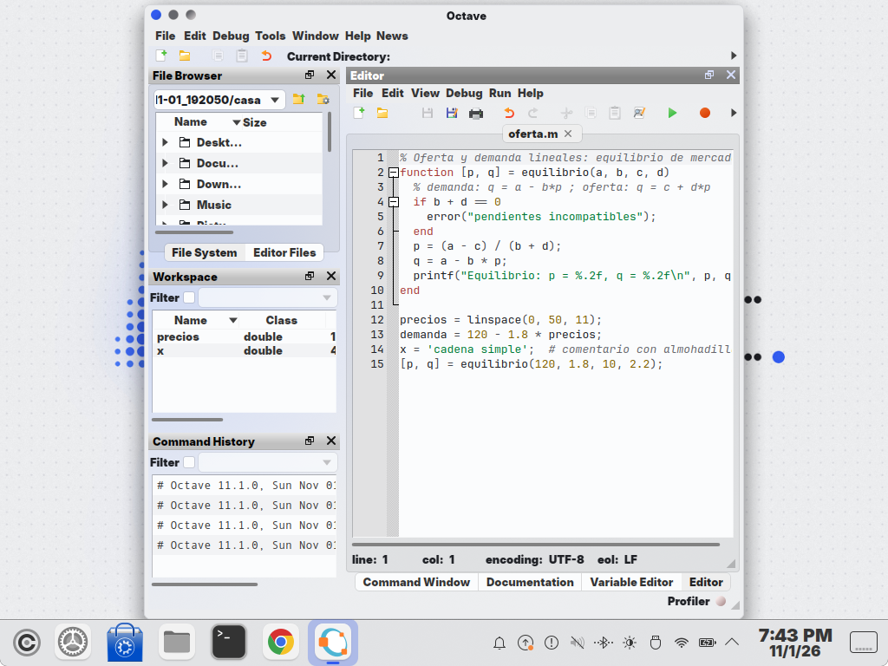
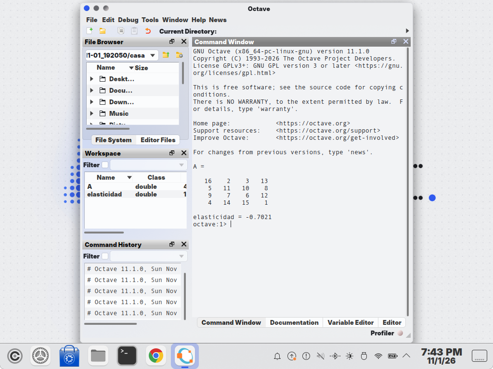

| | |
|---|---|
| papel | complemento (paquete) |
| estado | **probado** |
| tecnología | `$XDG_CONFIG_HOME/octave/octave-gui.ini` (QSettings ini de Octave ≥ 7, probado en 11.1.0): colores `QColor` de los dos modos (`…` y `…_2`), lexers de QScintilla 2.14 en `[Scintilla]` y `[Scintilla_2]`, interruptores `*/color_mode` |
| desde la versión | 0.4.0 |
| archivos | `lliphi.ini`, `octave-lliphi.py` |
| licencia | CC-BY-SA-4.0 |





# GNU Octave: instalar, actualizar y desinstalar

Octave tiene que haberse abierto al menos una vez (su asistente de bienvenida crea `~/.config/octave/octave-gui.ini`):
sin ese archivo el programa no crea nada y lo dice.

## Instalar

1. Cierra Octave (no es imprescindible: el cambio se ve al abrirlo de nuevo).
2. Con el instalador de Lliphi, que respalda antes `octave-gui.ini` (simula sin `--aplicar`):

```bash
python3 herramientas/instalar.py --modulos octave --aplicar --aplicar-tema oscuro
```

   `--aplicar-tema` aplica también el tema global de Plasma. Si solo quieres Octave, instala el programa y ejecútalo:

```bash
python3 herramientas/instalar.py --modulos octave --aplicar
cp ~/.config/octave/octave-gui.ini ~/.config/octave/octave-gui.ini.antes      # tu copia
python3 ~/.local/share/lliphi/variante.d/octave.py oscuro --colores            # simula: dice qué cambiaría
python3 ~/.local/share/lliphi/variante.d/octave.py oscuro --colores --aplicar
```

3. Abre Octave. En Edit → Preferences (Editar → Preferencias), las casillas «Second color mode (light/dark)» de
   «Editor Styles», «Command Window Colors», «Variable Editor Colors» y «Workspace» quedan marcadas en el oscuro y
   desmarcadas en el claro: el programa las deja así.

## Seguir al claro y al oscuro

Octave no sigue al escritorio: el modo de color se elige a mano en Preferences, con esas cuatro casillas «Second
color mode». Con Lliphi:

- **Automático:** instala también `fondo-variante`. En cada cambio de variante su vigilancia ejecuta
  `~/.local/share/lliphi/variante.d/octave.py <variante> --aplicar`, que cambia los cuatro interruptores si los colores
  son de Lliphi (con otros colores no toca nada). Se ve al abrir Octave de nuevo.
- **A mano:** `python3 ~/.local/share/lliphi/variante.d/octave.py claro --aplicar` (o `oscuro`), o las casillas de
  Preferencias.

## Actualizar

Vuelve a ejecutar el paso 2: el programa reemplaza los colores de Lliphi por los nuevos y conserva lo demás.

## Desinstalar

Los colores se quitan desde Octave: en Preferences, el botón «Reload default colors» (o «Reload default styles» en
«Editor Styles») de cada una de las cuatro secciones, en cada modo; o devuelve tu copia (`octave-gui.ini.antes`), o
ejecuta el `UNDO.sh` del respaldo del instalador, que restaura `octave-gui.ini` tal como estaba.


## Código, incidencias y cambios

- Código: [`complementos/octave/`](https://github.com/achalmed/lliphi/tree/main/complementos/octave) (manifiesto, fuente y su `README.md`); lo generado, en [`generado/octave`](https://github.com/achalmed/lliphi/tree/main/generado/octave).
- Incidencias: [https://github.com/achalmed/lliphi/issues](https://github.com/achalmed/lliphi/issues?q=label%3Aoctave).
- Cambios: [registro de cambios](../../cambios.qmd).
