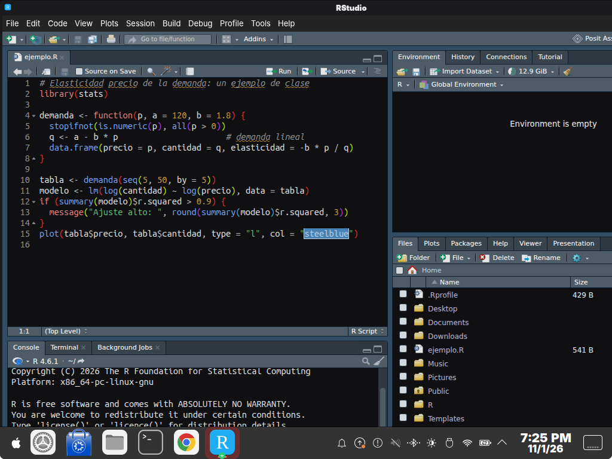
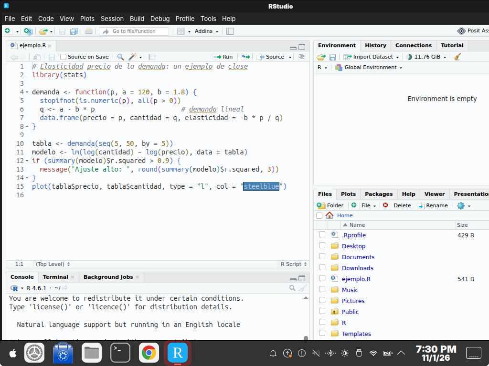
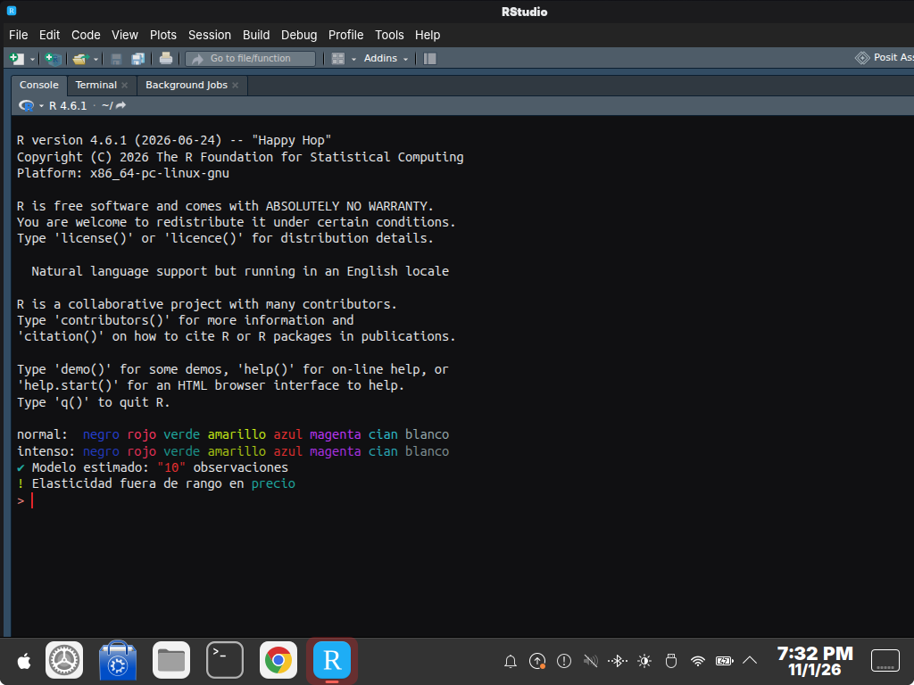
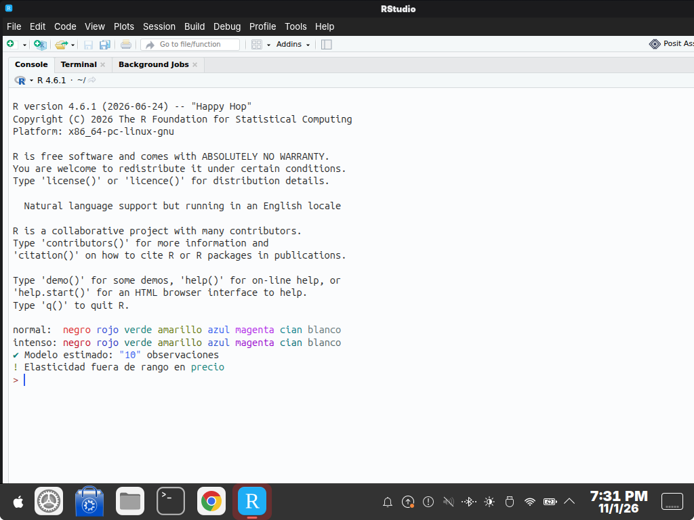

| | |
|---|---|
| papel | complemento (paquete) |
| estado | **probado** |
| tecnología | RStudio theme `.rstheme` (CSS sobre Ace con `rs-theme-name` y `rs-theme-is-dark`; RStudio ≥ 1.2, probado en 2026.05.1) en `~/.config/rstudio/themes/` · `editor_theme` de `rstudio-prefs.json` |
| desde la versión | 0.4.0 |
| archivos | `Lliphi Claro.rstheme`, `Lliphi Oscuro.rstheme`, `variante-rstudio.py` |
| licencia | CC-BY-SA-4.0 |






# RStudio: instalar, actualizar y desinstalar

## Instalar

Con el instalador de Lliphi (simula sin `--aplicar`):

```bash
python3 herramientas/instalar.py --modulos rstudio --aplicar
```

copia **Lliphi Claro.rstheme** y **Lliphi Oscuro.rstheme** a `~/.config/rstudio/themes/` (RStudio ≥ 1.3 lee de ahí los
temas del usuario; con `RSTUDIO_CONFIG_HOME` definido, de esa carpeta). Después, en RStudio: Tools → Global Options →
Appearance → Editor theme → **Lliphi Oscuro** o **Lliphi Claro** → Apply. La interfaz entera se vuelve clara u oscura
con el tema.

A mano, sin el instalador, cualquiera de estas dos formas:

```bash
cp "generado/rstudio/Lliphi Claro.rstheme" "generado/rstudio/Lliphi Oscuro.rstheme" ~/.config/rstudio/themes/
```

```r
rstudioapi::addTheme("generado/rstudio/Lliphi Oscuro.rstheme", apply = TRUE)
rstudioapi::addTheme("generado/rstudio/Lliphi Claro.rstheme")
```

## Seguir al claro y al oscuro

RStudio no cambia de tema cuando el escritorio pasa de claro a oscuro. Con Lliphi hay dos caminos:

- **Automático:** instala también `fondo-variante` (`--modulos rstudio,fondo-variante`). Su vigilancia, en cada cambio de
  variante, ejecuta `~/.local/share/lliphi/variante.d/rstudio.py`, que pone en `editor_theme` el tema de la variante
  si el que había era de Lliphi (con otro tema no toca nada). RStudio lee ese archivo al arrancar: el cambio se ve al
  abrirlo de nuevo (con RStudio abierto no lo relee, y si entretanto cambias una preferencia puede volver a escribir el
  tema que tenía). El instalador lo deja listo con `--aplicar-tema`.
- **A mano:** elige el otro tema en Global Options → Appearance, o en la consola de R
  `rstudioapi::applyTheme("Lliphi Claro")`.

Para probar el programa sin escribir nada: `python3 ~/.local/share/lliphi/variante.d/rstudio.py claro` (simula);
con `--aplicar`, lo cambia.

## Actualizar

Vuelve a instalar (`instalar.py --modulos rstudio --aplicar`): los `.rstheme` se reemplazan. RStudio relee el tema al
volver a elegirlo o al reiniciar.

## Desinstalar

Elige otro tema en Global Options → Appearance y borra los dos archivos de `~/.config/rstudio/themes/` (o
`rstudioapi::removeTheme("Lliphi Oscuro")`). `instalar.py desinstalar --aplicar` los retira con lo demás de Lliphi, y el
`UNDO.sh` del respaldo devuelve `rstudio-prefs.json` como estaba.


## Código, incidencias y cambios

- Código: [`complementos/rstudio/`](https://github.com/achalmed/lliphi/tree/main/complementos/rstudio) (manifiesto, fuente y su `README.md`); lo generado, en [`generado/rstudio`](https://github.com/achalmed/lliphi/tree/main/generado/rstudio).
- Incidencias: [https://github.com/achalmed/lliphi/issues](https://github.com/achalmed/lliphi/issues?q=label%3Arstudio).
- Cambios: [registro de cambios](../../cambios.qmd).
