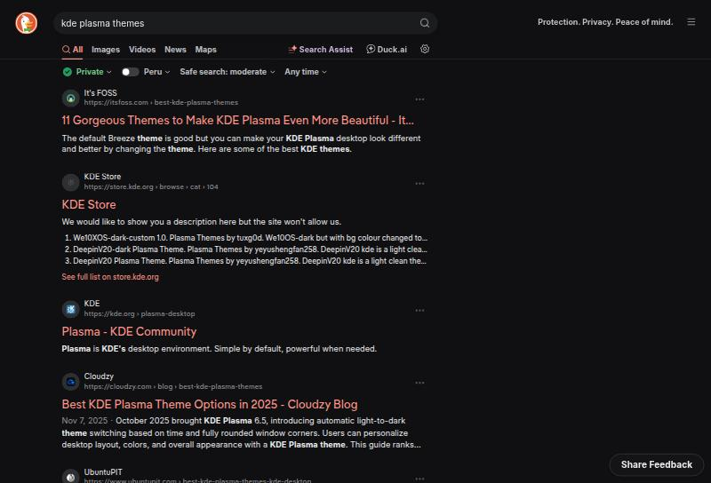
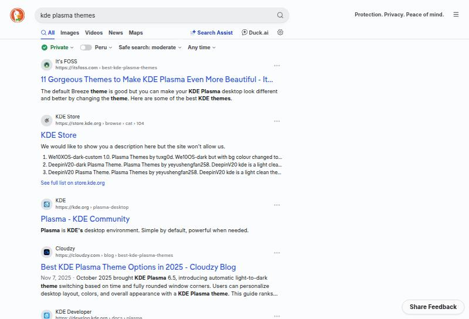
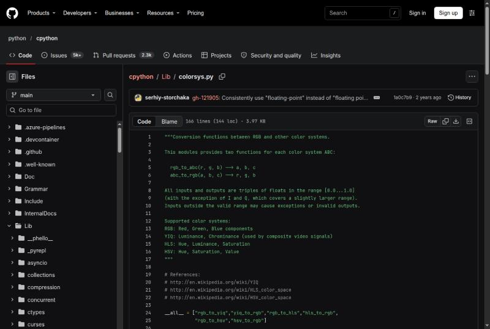
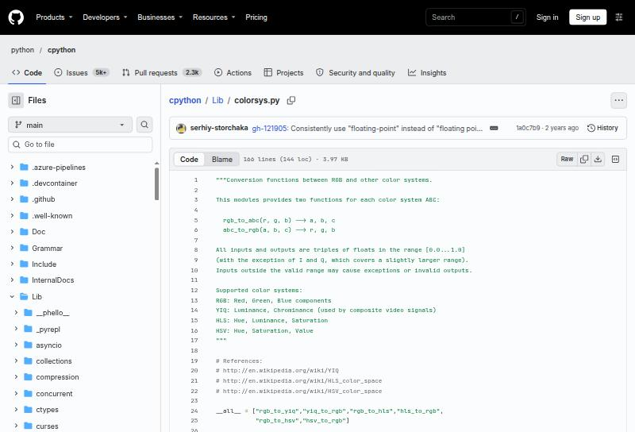
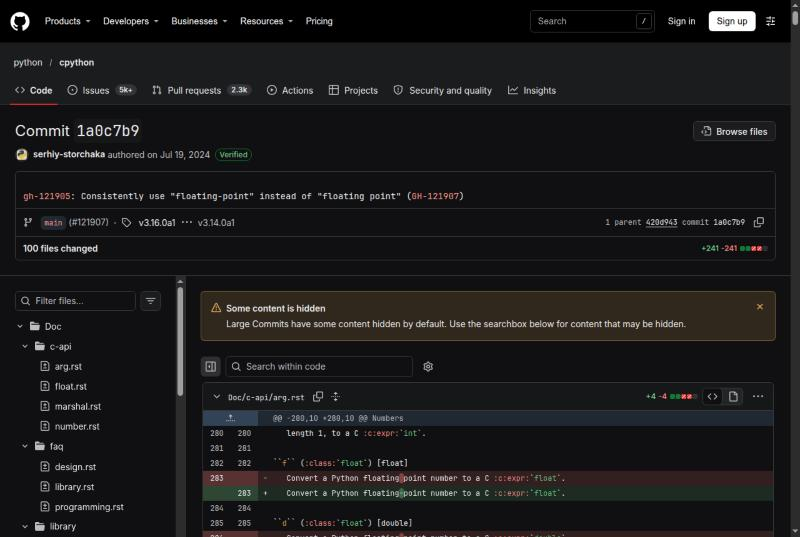
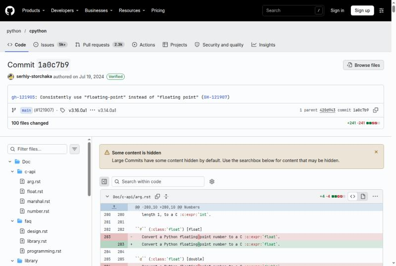

| | |
|---|---|
| papel | complemento (paquete) |
| estado | **experimental** |
| tecnología | UserCSS (`==UserStyle==`, `@-moz-document domain(...)`) para Stylus ≥ 1.5 en Zen (Firefox) y Chrome, o `chrome/userContent.css` del perfil de Zen · DuckDuckGo: variables `--theme-col-*` y parámetros de apariencia (`kae`, `k7`, `kj`, `k8`, `k9`, `kaa`, `kx`, `k21`, `kt`, `ka`) · GitHub: variables de Primer (`--bgColor-*`, `--fgColor-*`, `--borderColor-*`, `--button-*`, `--diffBlob-*`, `--prettylights-syntax-*`, `--fontStack-*`) por `data-color-mode` |
| desde la versión | 0.4.0 |
| archivos | `duckduckgo.user.css`, `github.user.css`, `duckduckgo/ajustes.json`, `duckduckgo/marcadores.html` |
| licencia | CC-BY-SA-4.0 |








## Instalar

El instalador de Lliphi **no toca el navegador**: los estilos se instalan en una extensión o en el perfil, a mano.
Los archivos están en `generado/sitios-web/` (o en el repositorio, en la misma ruta). Ninguno guarda datos personales.

Antes de empezar, en los dos sitios conviene dejar el modo que sigue al sistema, para que lo que el estilo no cubre
cambie a la vez:

- **DuckDuckGo:** Ajustes → Apariencia → Temas → **Predeterminado** (el que sigue al modo del sistema).
- **GitHub:** Settings → Appearance → Theme mode → **Sync with system** (el tema claro y el oscuro de debajo dan igual:
  el estilo los reemplaza). Si se elige «Single theme» claro u oscuro, el estilo sigue a esa elección.

### Con Stylus (Zen y Chrome)

Stylus es la extensión libre de estilos de usuario; no hay otra instalada en Zen ni en Chrome.

1. Instalar Stylus:
   - **Zen** (es Firefox): [addons.mozilla.org/firefox/addon/styl-us](https://addons.mozilla.org/firefox/addon/styl-us/).
   - **Chrome**: [Chrome Web Store, «Stylus»](https://chromewebstore.google.com/detail/stylus/clngdbkpkpeebahjckkjfobafhncgmne).
2. Instalar cada estilo, de una de estas dos formas:
   - **Desde el repositorio** (cuando esté publicado): abrir la URL «raw» del archivo, por ejemplo
     `https://raw.githubusercontent.com/achalmed/lliphi/main/generado/sitios-web/github.user.css`. Stylus reconoce
     el `.user.css`, muestra su página de instalación y pulsa **Instalar estilo**; además guarda esa URL y busca
     versiones nuevas desde ella (Gestionar → «Buscar actualizaciones»).
   - **Desde esta copia**: Stylus → **Gestionar** → marcar **«como UserCSS»** junto a «Escribir un estilo nuevo» →
     pulsar «Escribir un estilo nuevo» → pegar el contenido entero del `.user.css` (con su cabecera `==UserStyle==`) →
     **Guardar**.
3. Repetir con el otro sitio (`duckduckgo.user.css`, `github.user.css`).

La variante cambia sola: Stylus aplica el bloque claro o el oscuro según el modo de color que el navegador da a las
páginas (en Zen, Ajustes → General → Apariencia de los sitios web: **Automático**; en Chrome, el modo del sistema o el
de Ajustes → Aspecto → Modo).

### En Zen sin extensión (`userContent.css`)

Zen lee `chrome/userContent.css` del perfil si `toolkit.legacyUserProfileCustomizations.stylesheets` está activa (la
activa el `user.js` del complemento `navegadores`, o se pone a `true` en `about:config`). Los estilos ya van envueltos
en `@-moz-document domain(...)`, que Firefox entiende sin extensión:

```bash
PERFIL="$HOME/.var/app/app.zen_browser.zen/.zen/<perfil>"      # Flatpak; sin Flatpak: ~/.zen/<perfil>
mkdir -p "$PERFIL/chrome"
cp -n "$PERFIL/chrome/userContent.css" "$PERFIL/chrome/userContent.css.antes-lliphi" 2>/dev/null   # respaldo, si existe
cat generado/sitios-web/duckduckgo.user.css generado/sitios-web/github.user.css >> "$PERFIL/chrome/userContent.css"
```

El nombre del perfil está en `about:profiles`. Zen lo carga al reiniciar. `>>` añade al final: si ya había un
`userContent.css`, lo conserva.

### DuckDuckGo sin extensión (sus propios ajustes)

DuckDuckGo deja fijar sus colores y su fuente. Un juego de ajustes no sigue al sistema, así que hay uno por variante,
en `generado/sitios-web/duckduckgo/ajustes.json`:

- **Guardarlos** (cookies del navegador): abrir la URL `ajustes` de la variante (la página de ajustes ya rellena con los
  colores de Lliphi) y pulsar **Guardar y salir**. Para tenerlos en otros navegadores, «Guardado en la nube» → «Guardar
  ajustes» en la misma página.
- **Como marcadores**: importar `duckduckgo/marcadores.html` (Zen: Marcadores → Gestionar marcadores → Importar y
  respaldar → Importar marcadores desde HTML; Chrome: Marcadores → Gestor de marcadores → ⋮ → Importar marcadores). Trae
  la página de inicio y la de ajustes de cada variante, en una carpeta «Lliphi».
- **Como buscador**: la URL `buscador` (`https://duckduckgo.com/?q=%s&…`) en Zen, Ajustes → Buscar → Buscadores →
  Añadir; en Chrome, Ajustes → Buscador → Gestionar buscadores → Búsqueda en sitios → Añadir. Cada búsqueda sale con los
  colores de Lliphi sin tocar las cookies.

Con el estilo de usuario instalado no hace falta nada de esto (y conviene dejar el tema «Predeterminado»).

## Actualizar

- **Stylus:** si se instaló desde la URL «raw», Gestionar → «Buscar actualizaciones»; si se pegó, abrir el estilo y
  reemplazar el texto por el nuevo.
- **userContent.css:** quitar los dos bloques de Lliphi (de `/* ==UserStyle==` a su `}` final) y volver a añadirlos.
- **DuckDuckGo:** volver a abrir la URL `ajustes` y guardar.

## Desinstalar

- **Stylus:** Gestionar → el estilo → **Borrar** (o desactivarlo con su casilla).
- **userContent.css:** quitar los bloques de Lliphi o reponer `userContent.css.antes-lliphi`.
- **DuckDuckGo:** Ajustes → **Restablecer todos los ajustes de búsqueda**.


## Código, incidencias y cambios

- Código: [`complementos/sitios-web/`](https://github.com/achalmed/lliphi/tree/main/complementos/sitios-web) (manifiesto, fuente y su `README.md`); lo generado, en [`generado/sitios-web`](https://github.com/achalmed/lliphi/tree/main/generado/sitios-web).
- Incidencias: [https://github.com/achalmed/lliphi/issues](https://github.com/achalmed/lliphi/issues?q=label%3Asitios-web).
- Cambios: [registro de cambios](../../cambios.qmd).
