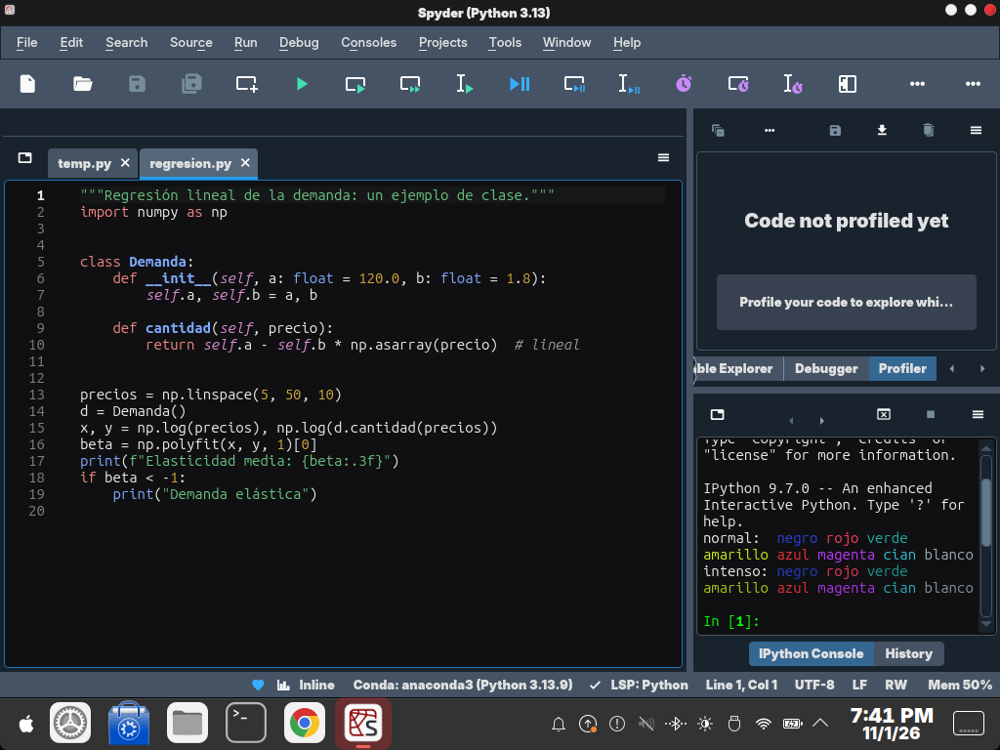
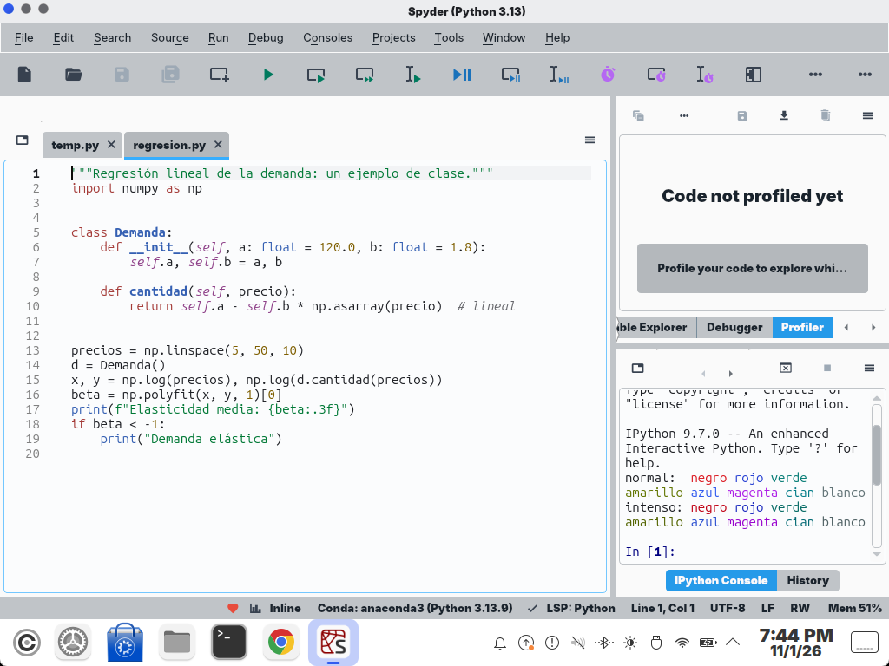

| | |
|---|---|
| papel | complemento (paquete) |
| estado | **probado** |
| tecnología | `[appearance]` de `$XDG_CONFIG_HOME/spyder-py3/config/spyder.ini` (17 claves por esquema, `names`, `selected`, `ui_theme = automatic`; Spyder ≥ 5, probado en 6.1.0) · secuencias OSC 4 de xterm en la consola IPython (qtconsole) con `startup/run_file` |
| desde la versión | 0.4.0 |
| archivos | `spyder-lliphi.py`, `consola.py` |
| licencia | CC-BY-SA-4.0 |




# Spyder: instalar, actualizar y desinstalar

Spyder tiene que haberse abierto al menos una vez (crea `~/.config/spyder-py3/config/spyder.ini`) y estar **cerrado**
al instalar: mientras está abierto reescribe ese archivo entero y se perdería el cambio. Da igual cómo esté instalado
(Anaconda, conda, pip): todos usan la misma carpeta de configuración.

## Instalar

Con el instalador de Lliphi, que respalda antes `spyder.ini` (simula sin `--aplicar`):

```bash
python3 herramientas/instalar.py --modulos spyder --aplicar --aplicar-tema oscuro
```

`--aplicar-tema` aplica también el tema global de Plasma. Si solo quieres Spyder, instala los programas y ejecuta el suyo:

```bash
python3 herramientas/instalar.py --modulos spyder --aplicar
cp ~/.config/spyder-py3/config/spyder.ini ~/.config/spyder-py3/config/spyder.ini.antes   # tu copia
python3 ~/.local/share/lliphi/variante.d/spyder.py oscuro --esquemas                     # simula
python3 ~/.local/share/lliphi/variante.d/spyder.py oscuro --esquemas --aplicar
```

Al abrir Spyder: Tools → Preferences → Appearance muestra el esquema **Lliphi Oscuro** (o **Lliphi Claro**) y la
interfaz en «Automatic». En Preferences → IPython console → Startup queda marcado «Execute the following file» con
`~/.local/share/lliphi/spyder/consola.py`: es el que da a la consola los dieciséis colores de la terminal. Si ya
ejecutabas otro archivo al arrancar, el programa no lo cambia (lo dice); para tener los colores, añade al final de tu
archivo `exec(open("<ruta de consola.py>", encoding="utf-8").read())`.

## Seguir al claro y al oscuro

Spyder no sigue al escritorio. Con Lliphi:

- **Automático:** instala también `fondo-variante`. En cada cambio de variante su vigilancia ejecuta
  `~/.local/share/lliphi/variante.d/spyder.py <variante> --aplicar`, que elige el esquema de la variante si el elegido
  era de Lliphi y Spyder está cerrado (abierto, no lo toca: la próxima vez que cambie la variante con Spyder cerrado, o
  a mano). Se ve al abrir Spyder.
- **A mano:** Preferences → Appearance → Syntax highlighting theme → el otro esquema → Apply; Spyder pide reiniciarse
  para cambiar la interfaz. O, con Spyder cerrado, `python3 ~/.local/share/lliphi/variante.d/spyder.py claro --aplicar`.

Al cambiar de esquema con Spyder abierto, las consolas IPython ya abiertas vuelven a los colores ANSI de qtconsole hasta
que se reinician (Consoles → Restart kernel, o una consola nueva).

## Actualizar

Con Spyder cerrado, vuelve a ejecutar el programa con `--esquemas --aplicar`: reemplaza los dos esquemas por los nuevos.

## Desinstalar

En Preferences → Appearance elige otro esquema, y en IPython console → Startup desmarca «Execute the following file».
Los esquemas de Lliphi quedan en la lista; para quitarlos del todo, devuelve tu copia (`spyder.ini.antes`) o ejecuta el
`UNDO.sh` del respaldo del instalador, con Spyder cerrado.


## Código, incidencias y cambios

- Código: [`complementos/spyder/`](https://github.com/achalmed/lliphi/tree/main/complementos/spyder) (manifiesto, fuente y su `README.md`); lo generado, en [`generado/spyder`](https://github.com/achalmed/lliphi/tree/main/generado/spyder).
- Incidencias: [https://github.com/achalmed/lliphi/issues](https://github.com/achalmed/lliphi/issues?q=label%3Aspyder).
- Cambios: [registro de cambios](../../cambios.qmd).
