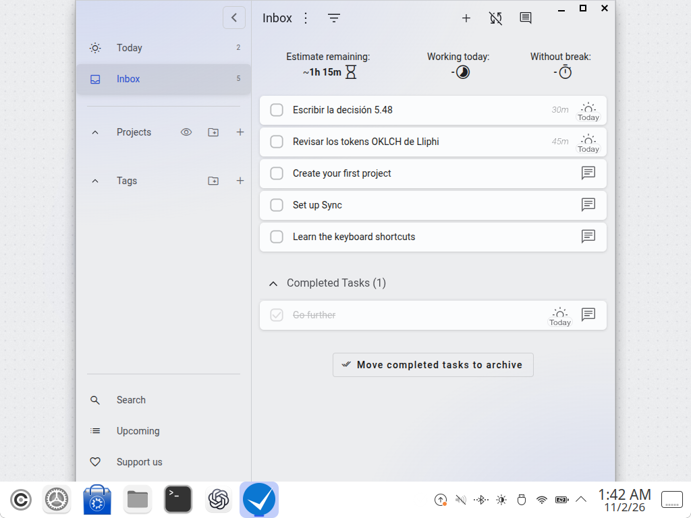
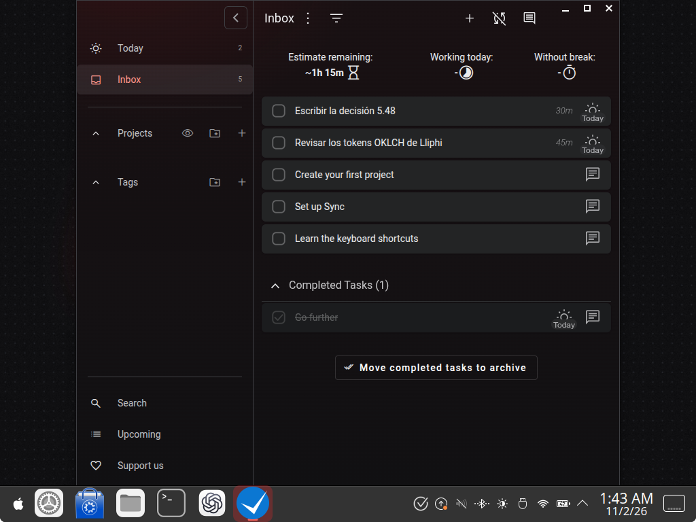
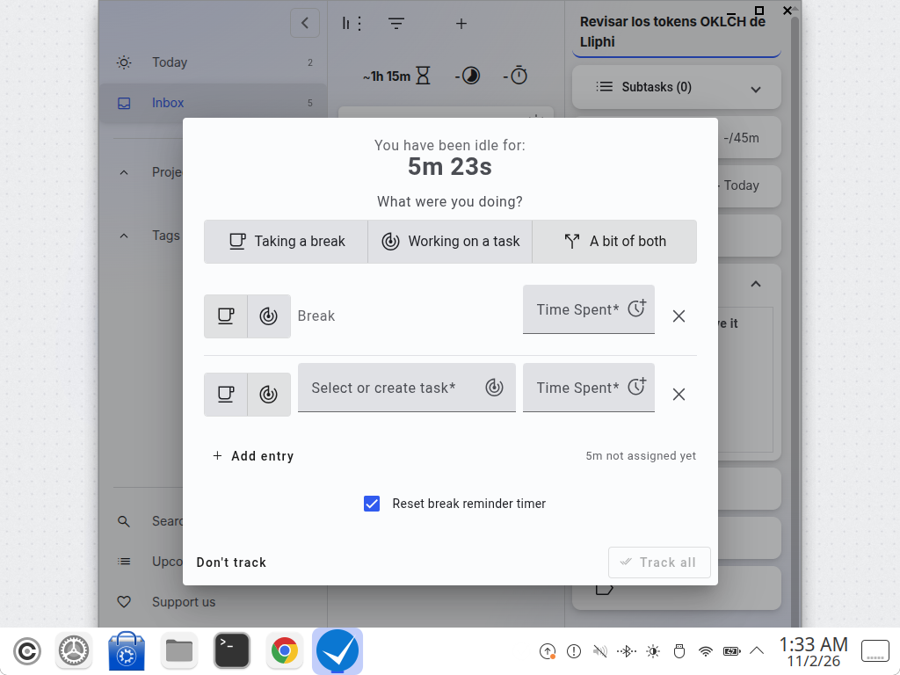
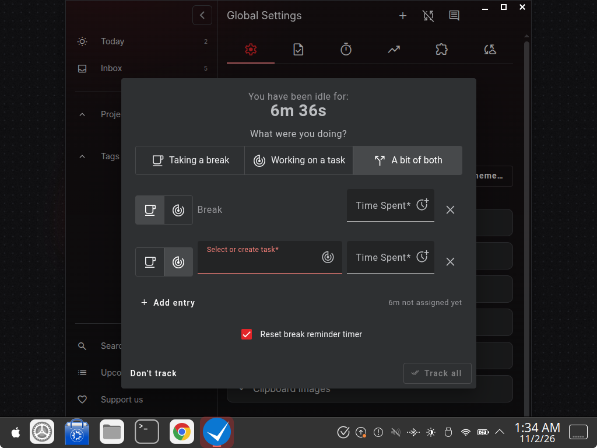
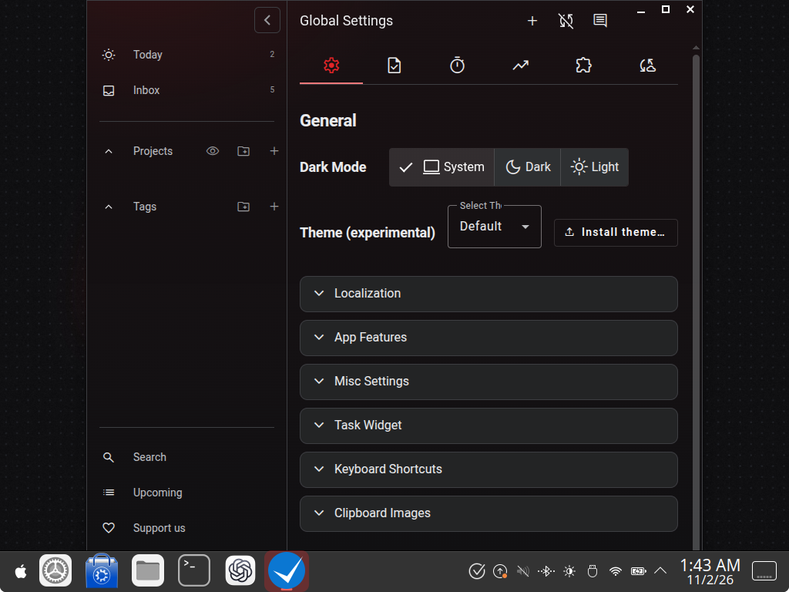

| | |
|---|---|
| papel | complemento (paquete) |
| estado | **probado** |
| tecnología | Super Productivity ≥ 18 (probado en 18.10.0, deb, Electron 41) · `styles.css` de su carpeta de datos (`webContents.insertCSS`) o tema de usuario CSS (Ajustes → General → «Instalar tema…») · variables de `_css-variables.scss` y clase `isDarkTheme` del cuerpo |
| desde la versión | 0.4.0 |
| archivos | `lliphi.css` |
| licencia | CC-BY-SA-4.0 |







# Super Productivity: instalar, actualizar y desinstalar

Hace falta Super Productivity 18 o posterior, abierto al menos una vez (así existe su carpeta de datos,
`~/.config/superProductivity/`; si no existe, el instalador omite este complemento y lo dice).

## Instalar

1. Con el instalador de Lliphi (simula sin `--aplicar`):

```bash
python3 herramientas/instalar.py --modulos super-productivity --aplicar
```

   Copia `lliphi.css` como `~/.config/superProductivity/styles.css` (con Flatpak,
   `~/.var/app/com.super_productivity.SuperProductivity/config/superProductivity/`; con Snap,
   `~/snap/superproductivity/common/.config/superProductivity/`; otra carpeta, con `SUPER_PRODUCTIVITY_CONFIG`). Si ya
   hay un `styles.css` tuyo, no lo toca y lo dice.
2. Cierra Super Productivity (también desde la bandeja) y ábrelo: lee `styles.css` al abrir la ventana.
3. En Ajustes → General, deja «Modo oscuro» en «Sistema» (lo predeterminado) y «Tema (experimental)» en «Default»:
   otro tema de la lista se sumaría a Lliphi.

**Desde la aplicación**, sin el instalador: Ajustes → General → «Instalar tema…», elige
`generado/super-productivity/lliphi.css`, después «Lliphi» en «Tema (experimental)» y «Sistema» en «Modo oscuro».

## Seguir al claro y al oscuro

Con «Modo oscuro: Sistema» la aplicación sigue al esquema de color de Plasma: al pasar de Lliphi Claro a Lliphi
Oscuro (a mano o con la vigilancia de [`fondo-variante`](../fondo-variante/README.md)) cambia sola, sin reiniciar.
«Oscuro» o «Claro» la fijan en una variante.

## Actualizar

Vuelve a ejecutar el paso 1 y reabre la aplicación (o, si lo instalaste desde la aplicación, instala otra vez
`lliphi.css`: el tema del mismo nombre se reemplaza).

## Desinstalar

`python3 herramientas/instalar.py desinstalar --aplicar` (o el `UNDO.sh` del respaldo) retira `styles.css`; se ve al
reabrir la aplicación. Si lo instalaste desde la aplicación, quítalo en «Tema (experimental)» con el botón de borrar
junto a «Lliphi».


## Código, incidencias y cambios

- Código: [`complementos/super-productivity/`](https://github.com/achalmed/lliphi/tree/main/complementos/super-productivity) (manifiesto, fuente y su `README.md`); lo generado, en [`generado/super-productivity`](https://github.com/achalmed/lliphi/tree/main/generado/super-productivity).
- Incidencias: [https://github.com/achalmed/lliphi/issues](https://github.com/achalmed/lliphi/issues?q=label%3Asuper-productivity).
- Cambios: [registro de cambios](../../cambios.qmd).
