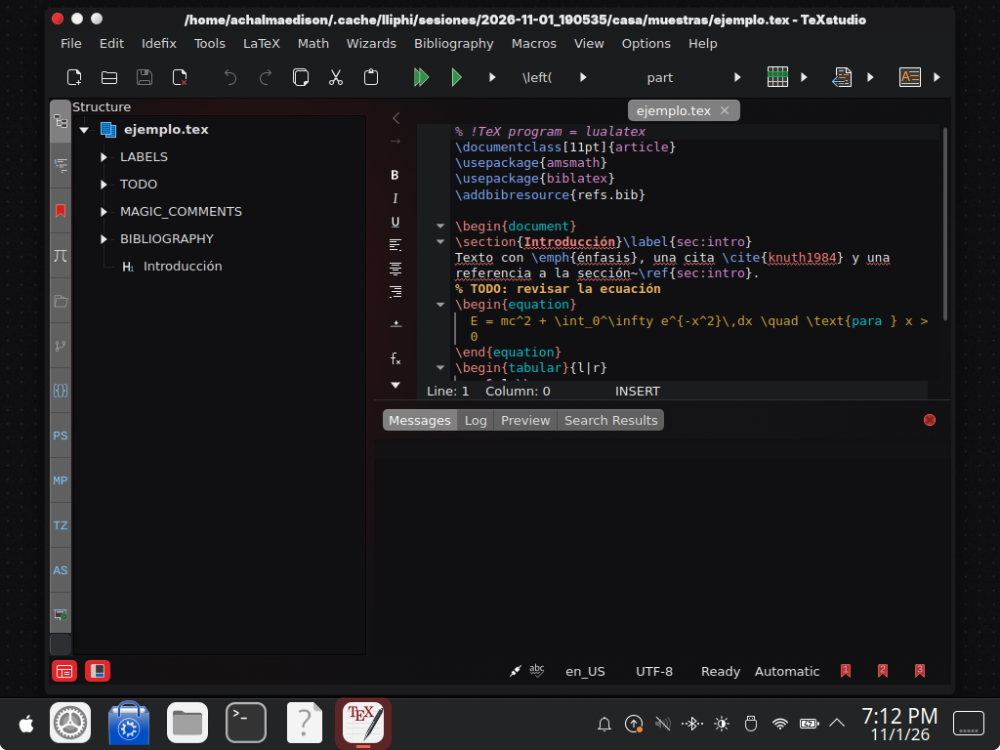
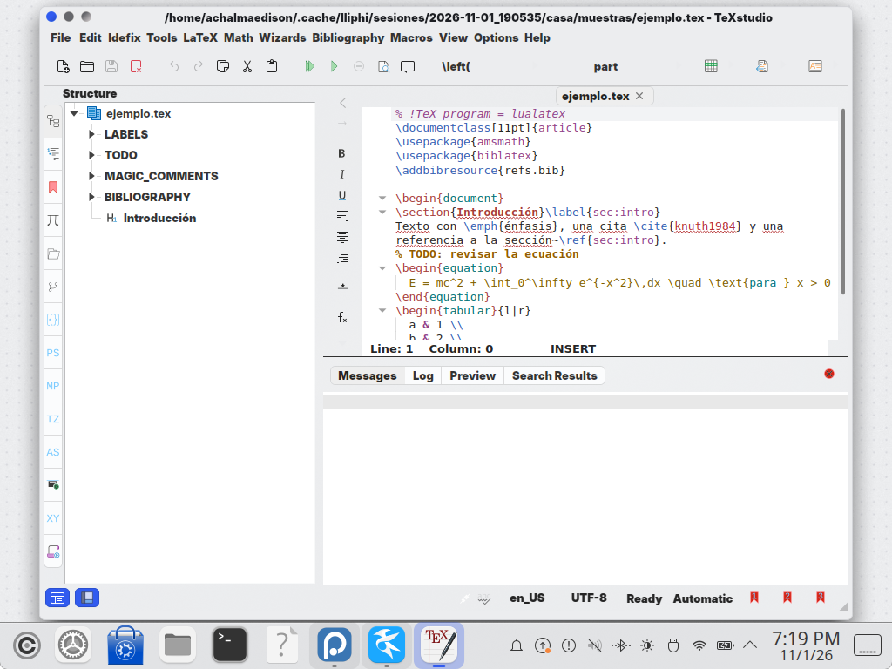

| | |
|---|---|
| papel | complemento (paquete) |
| estado | **probado** |
| tecnología | TeXstudio 4.x: `[formats]` y `[formatsDark]` de `texstudio.ini` (`QFormatScheme`, grupos `data/<formato>`), elegidas por `ConfigManager::systemUsesDarkMode` · perfil `.txsprofile` (Opciones → Cargar perfil…) |
| desde la versión | 0.4.0 |
| archivos | `lliphi.txsprofile` |
| licencia | CC-BY-SA-4.0 |

## Instalar

Con TeXstudio **cerrado**, una de las dos:

- **Desde TeXstudio**: Opciones → Cargar perfil… → `generado/texstudio/lliphi.txsprofile`. Solo cambia los formatos
  de resaltado (las dos variantes); lo demás de tu configuración queda igual. Esto sí puede hacerse con TeXstudio
  abierto: el perfil se aplica al momento.
- **Con el instalador**: `python3 herramientas/instalar.py --modulos texstudio --aplicar --aplicar-tema oscuro` (la
  variante da igual: se escriben las dos). Respalda `~/.config/texstudio/texstudio.ini`, deja un `UNDO.sh` y cambia
  solo `[formats]` y `[formatsDark]`.

TeXstudio usa la sección de la variante del sistema y cambia sola al pasar de Lliphi Claro a Lliphi Oscuro, siempre
que no use la paleta de Texmaker (`GUI\Texmaker%20Palette=false` en `texstudio.ini`, el valor por omisión; en
Opciones → Configurar TeXstudio → General).

## Actualizar

Vuelve a cargar el perfil o a aplicar con el instalador.

## Desinstalar

Ejecuta el `UNDO.sh` del respaldo (restaura `texstudio.ini` entero), o en Opciones → Configurar TeXstudio → Resaltado
de sintaxis restablece los formatos.

## Código, incidencias y cambios

- Código: [`complementos/texstudio/`](https://github.com/achalmed/lliphi/tree/main/complementos/texstudio) (manifiesto, fuente y su `README.md`); lo generado, en [`generado/texstudio`](https://github.com/achalmed/lliphi/tree/main/generado/texstudio).
- Incidencias: [https://github.com/achalmed/lliphi/issues](https://github.com/achalmed/lliphi/issues?q=label%3Atexstudio).
- Cambios: [registro de cambios](../../cambios.qmd).
