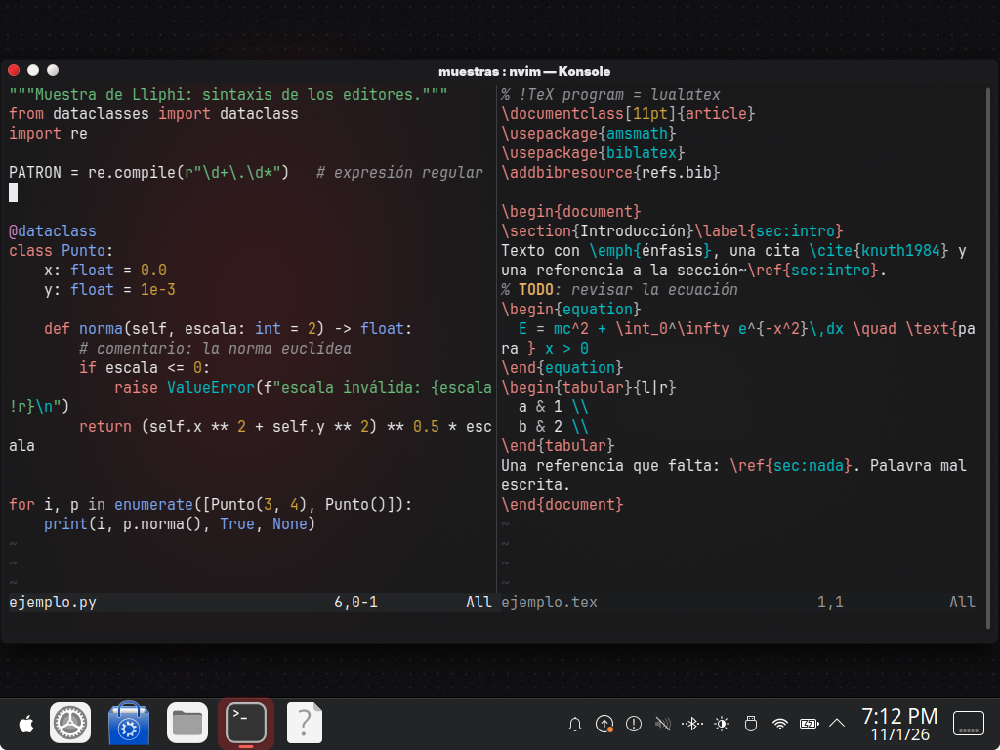
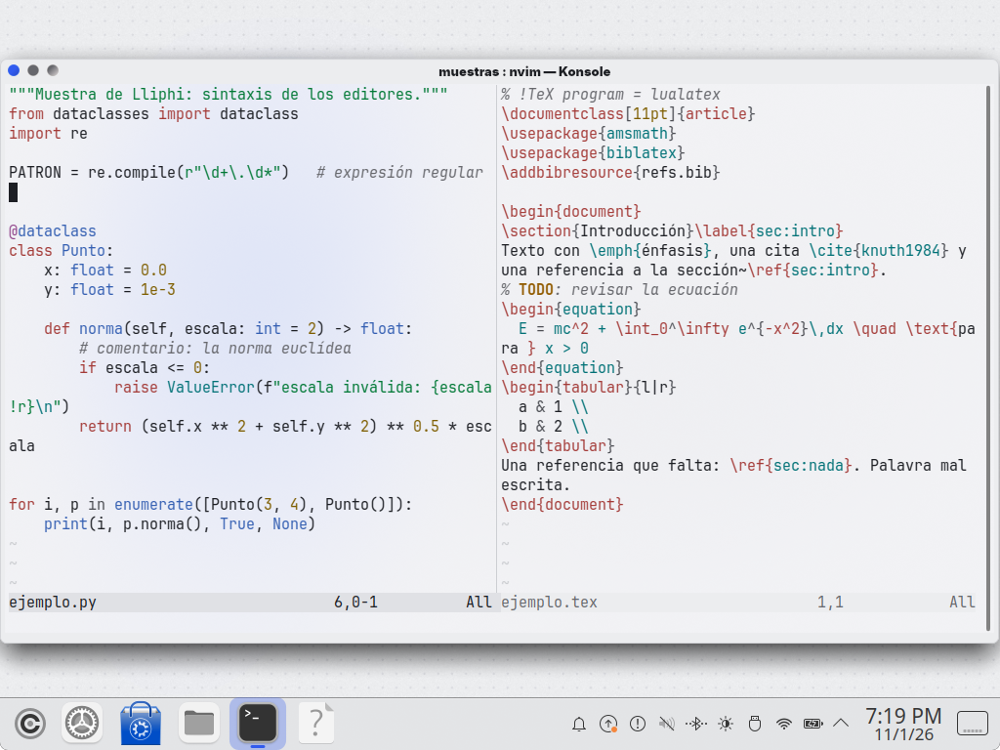

| | |
|---|---|
| papel | complemento (paquete) |
| estado | **probado** |
| tecnología | esquema de colores de Vim script (`colors/lliphi.vim`, `:highlight`, `g:terminal_ansi_colors`) que lee también Neovim (grupos `@…` y `g:terminal_color_N` bajo `has('nvim')`); Neovim lo encuentra en `$XDG_DATA_HOME/nvim/site/colors/` |
| desde la versión | 0.4.0 |
| archivos | `colors/lliphi.vim` |
| licencia | CC-BY-SA-4.0 |




## Instalar

```bash
python3 herramientas/instalar.py --modulos vim --aplicar
```

Copia el esquema a `~/.local/share/nvim/site/colors/lliphi.vim`.

**Neovim** lo encuentra ahí. En `~/.config/nvim/init.lua`:

```lua
vim.cmd.colorscheme("lliphi")
```

(o `colorscheme lliphi` en `init.vim`). Neovim ≥ 0.10 activa solo los colores verdaderos y deduce `background` del fondo
de la terminal.

**Vim** busca los esquemas en `~/.vim/colors/`. Enlaza el instalado (así se actualiza con él) y actívalo en `~/.vimrc`:

```bash
mkdir -p ~/.vim/colors
ln -s ~/.local/share/nvim/site/colors/lliphi.vim ~/.vim/colors/lliphi.vim
```

```vim
set termguicolors
colorscheme lliphi
```

No fijes `background` en la configuración: así Vim y Neovim lo toman de Konsole y abren en la variante de Plasma. En
una sesión que ya estaba abierta cuando cambiaste de variante, `:set background=light` (o `dark`) la cambia.

## Actualizar

Vuelve a instalar; en un editor abierto, `:colorscheme lliphi`.

## Desinstalar

`python3 herramientas/instalar.py desinstalar --aplicar` (retira lo de todos los módulos) o borra
`~/.local/share/nvim/site/colors/lliphi.vim` y el enlace de `~/.vim/colors/`, y quita `colorscheme lliphi` de tu
configuración.


## Código, incidencias y cambios

- Código: [`complementos/vim/`](https://github.com/achalmed/lliphi/tree/main/complementos/vim) (manifiesto, fuente y su `README.md`); lo generado, en [`generado/vim`](https://github.com/achalmed/lliphi/tree/main/generado/vim).
- Incidencias: [https://github.com/achalmed/lliphi/issues](https://github.com/achalmed/lliphi/issues?q=label%3Avim).
- Cambios: [registro de cambios](../../cambios.qmd).
