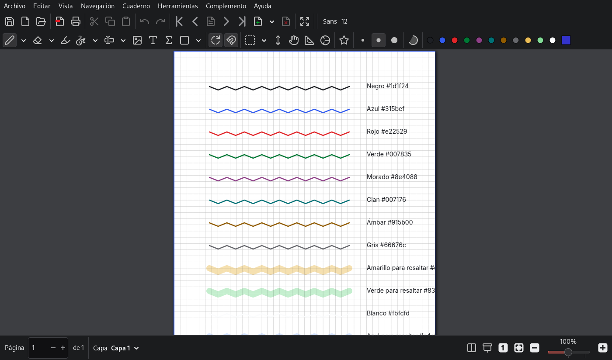
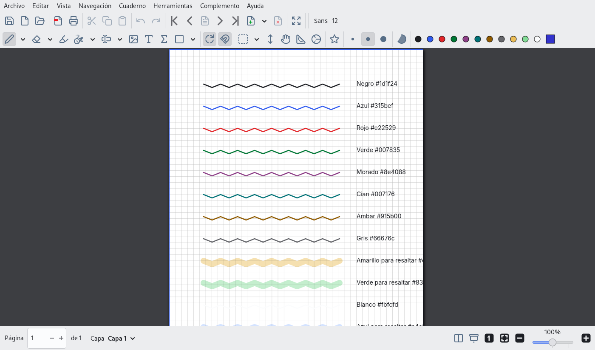

| | |
|---|---|
| papel | complemento (paquete) |
| estado | **probado** |
| tecnología | paleta «GIMP Palette» (`.gpl`) en `~/.config/xournalpp/palettes/` · propiedades de color de `settings.xml` (ARGB decimal: `backgroundColor`, `selection*Color`, `recolor.*`, `colorPalette`) |
| desde la versión | 0.4.0 |
| archivos | `palettes/Lliphi.gpl`, `settings-lliphi.xml` |
| licencia | MIT |




## Instalar

Con el instalador (simula sin `--aplicar`):

```bash
python3 herramientas/instalar.py --modulos gtk,xournalpp --aplicar --aplicar-tema oscuro
```

Copia la paleta a `~/.config/xournalpp/palettes/`, respalda `settings.xml` y, con Xournal++ cerrado, le pone la paleta
y los colores de Lliphi. Si Xournal++ está abierto, no lo toca.

A mano:

1. Copia `palettes/Lliphi.gpl` a `~/.config/xournalpp/palettes/`.
2. En Xournal++: Editar → Preferencias → pestaña de la paleta → elige **Lliphi** en «Paletas del usuario».
3. Opcional, con Xournal++ cerrado: copia las propiedades de `settings-lliphi.xml` sobre las del mismo nombre en
   `~/.config/xournalpp/settings.xml` (en `colorPalette`, la ruta completa de la paleta).
4. Para el modo oscuro: Preferencias → Ver → Tema → «Usar el del sistema».

## Actualizar

Sustituye la paleta; Xournal++ la relee al arrancar.

## Desinstalar

Elige otra paleta en Preferencias (o `UNDO.sh`, que devuelve `settings.xml`) y borra `Lliphi.gpl`.


## Código, incidencias y cambios

- Código: [`complementos/xournalpp/`](https://github.com/achalmed/lliphi/tree/main/complementos/xournalpp) (manifiesto, fuente y su `README.md`); lo generado, en [`generado/xournalpp`](https://github.com/achalmed/lliphi/tree/main/generado/xournalpp).
- Incidencias: [https://github.com/achalmed/lliphi/issues](https://github.com/achalmed/lliphi/issues?q=label%3Axournalpp).
- Cambios: [registro de cambios](../../cambios.qmd).
