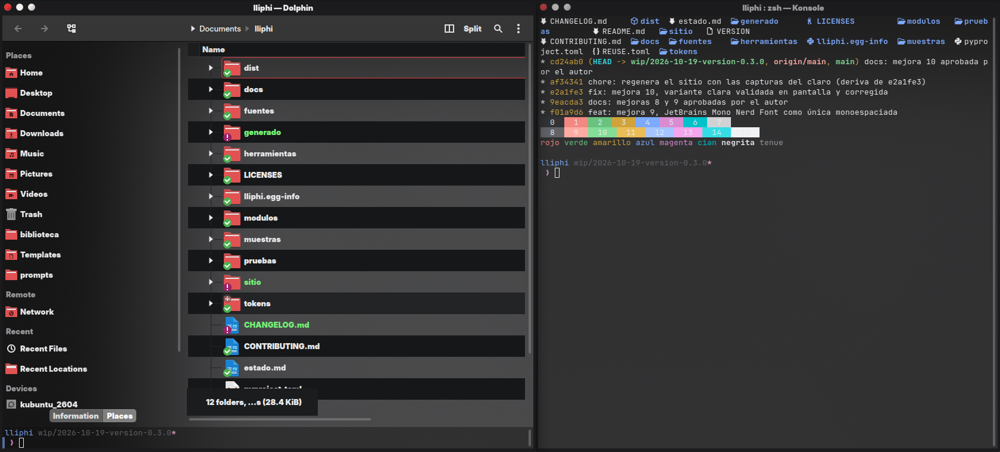
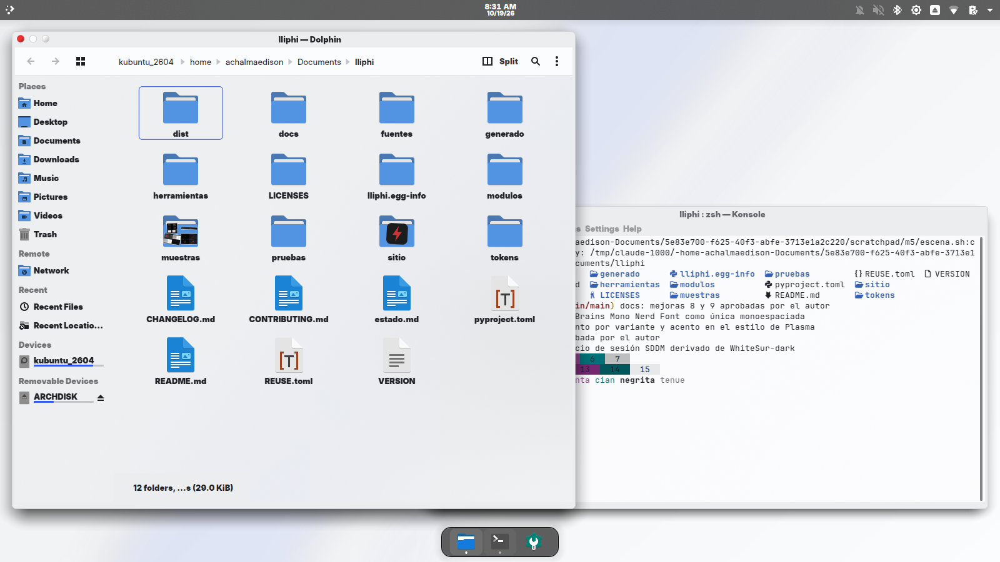

::: {.ll-portada}
{.lightbox}

{.lightbox}
:::

*Lliphi* («relámpago» en quechua) nace de dos temas que el autor usaba —la sobriedad casi negra y el acento rojo de
*Nothing*, la geometría redondeada y la familia claro/oscuro de *WhiteSur*— y de lo que a ambos les faltaba:
una sola fuente de verdad para los colores, contraste medido, instalación reversible, repositorio y sitio.

::: {.ll-rasgos}
::: {.ll-rasgo}
### Una fuente, todo generado
Los colores viven en un archivo de tokens (OKLCH, formato Design Tokens 2025.10). Esquemas de color, estilo de Plasma, Konsole y fondos se generan de ahí; una prueba falla si alguien edita lo generado a mano.
:::
::: {.ll-rasgo}
### Legible por contrato
Cada par texto/fondo cumple WCAG 2.2 (4.5:1) y cada foco, acento y borde de control supera 3:1, en las dos variantes. El script lo mide y las pruebas lo exigen.
:::
::: {.ll-rasgo}
### Un acento por variante
El oscuro lleva el rojo de Nothing (#c93436); el claro, el azul de WhiteSur (#315bef). Esquemas, estilo de Plasma, Kvantum, carpetas, Konsole, pantallas de carga e inicio de sesión siguen esa regla.
:::
::: {.ll-rasgo}
### Reversible de verdad
El instalador simula por defecto, escribe solo en tu carpeta de usuario, respalda tu configuración con suma SHA-256 y deja un `UNDO.sh`. Solo el inicio de sesión pide contraseña, con pkexec, y también deja su `UNDO.sh`.
:::
::: {.ll-rasgo}
### Derivado, no dibujado
Parte de lo mejor que ya existe: el estilo de Plasma, Kvantum, pantallas e inicio de sesión de WhiteSur; la decoración de Nothing; los iconos de Papirus; Inter y JetBrains Mono. Lliphi cambia solo lo necesario y lo deja medido.
:::
::: {.ll-rasgo}
### Sin marcas ajenas
Sin el logotipo de Apple ni fuentes propietarias. Código MIT, activos CC BY-SA 4.0 y lo derivado de WhiteSur y Nothing en GPL-3.0-or-later, declarado archivo por archivo (REUSE 3.3).
:::
:::

## Empezar

```bash
git clone https://github.com/achalmed/lliphi.git && cd lliphi
python3 herramientas/instalar.py              # simula: muestra qué haría
python3 herramientas/instalar.py --aplicar --aplicar-tema oscuro
```

Requiere Plasma 6 (probado en 6.6) y Python 3.10 o posterior; nada más. La guía completa está en
[Instalar](instalar.qmd); lo que hace cada pieza, en el [catálogo](catalogo.qmd).

## Estado del proyecto

Versión **0.3.0**: la configuración que el autor eligió (WhiteSur-dark con la decoración de Nothing) más diez mejoras,
cada una con captura de antes y después en la [galería](galeria.qmd). Lo probado, lo experimental y lo pendiente se
distinguen en cada página del catálogo y en [compatibilidad](compatibilidad.qmd).
