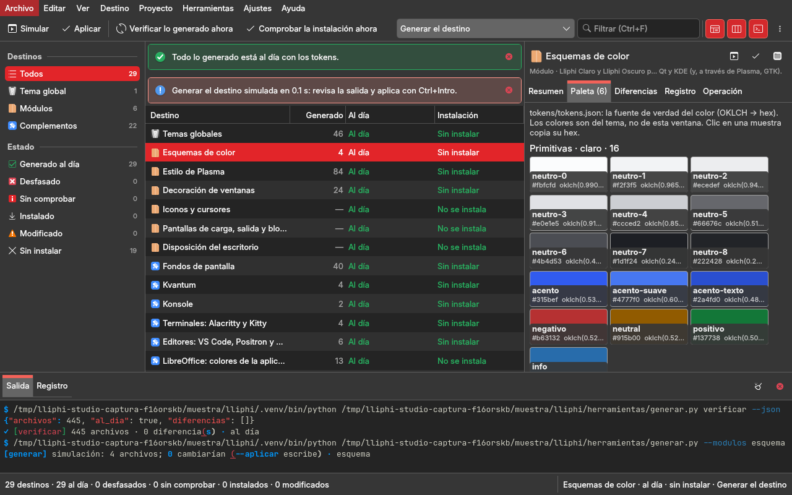
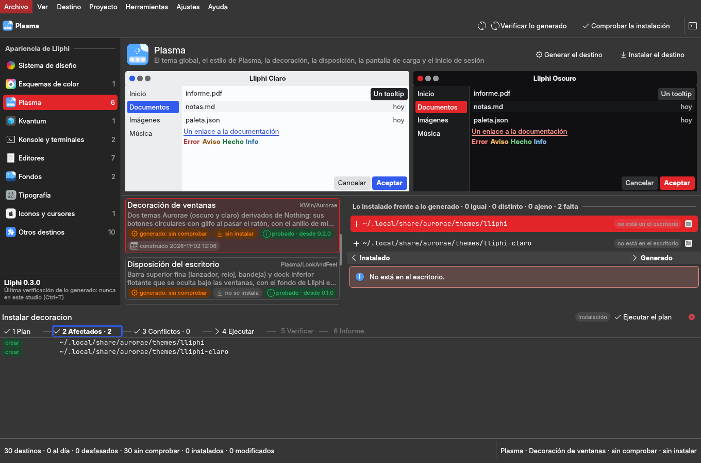

# studio/ — Lliphi Studio, la ventana opcional de Lliphi (QML + Kirigami sobre gui-comun 3.0)

Un **centro de configuración del escritorio** para el tema Lliphi, con la forma de las Preferencias del sistema de KDE.
Cada área tiene su página propia (no una tabla común):

- el sistema de diseño;
- los esquemas de color, Plasma, Kvantum, Konsole y terminales y los editores;
- los fondos, la tipografía, los iconos y cursores y los otros destinos.

**Es opcional**: todo lo de terminal (`herramientas/generar.py`, `instalar.py`, `sesion.py`,
`modulos/esquema/paleta.py`) funciona sin ella, y la ventana no reemplaza ninguna orden: las corre. Diseño y diagnóstico
en [`docs/reingenieria.md`](../docs/reingenieria.md), que sustituye a `docs/rediseno.md` (la 2.0).

```bash
/usr/bin/python3 -m venv --system-site-packages .venv && .venv/bin/pip install -r requirements.txt   # coloraide (paleta.py); una vez
python3 -m pip install --user "gui-comun @ git+https://github.com/achalmed/gui-comun.git@v3.0.0"      # o GUI_COMUN_DIR=<repo gui-comun>
/usr/bin/python3 studio/main.py                       # desde la raíz de lliphi (el PySide6 del sistema es el que carga Kirigami)
/usr/bin/python3 studio/main.py --area konsole        # abre en un área (o --destino <id>)
/usr/bin/python3 studio/main.py --instalar-lanzador   # acceso directo en el menú de aplicaciones (-n simula)
```



## La ventana

| parte | qué hay |
|---|---|
| barra lateral | las diez áreas con cuántos destinos tiene cada una (Ctrl+1 … Ctrl+0); al pie, la versión de Lliphi y la fecha de la última verificación de lo generado |
| cabecera | el área; Releer (F6), Verificar lo generado (Ctrl+T), Comprobar la instalación (Ctrl+Mayús+T), la salida (F4) |
| **Sistema de diseño** | claro y oscuro **lado a lado**, cada uno con: la maqueta de una ventana pintada con sus tokens; la escala de neutros en muestras grandes con L, C, H, hex y el paso de L entre vecinas; el acento y sus variantes; los estados; los 16 colores ANSI sobre su fondo; los **contrastes WCAG** de los pares que importan (texto sobre la ventana y las vistas, selección, texto sobre el acento, enlaces, estados, foco) con su razón y su veredicto (AAA · AA · AA grande · falla; ≥ 3 en los controles; el separador, decorativo) |
| las demás áreas | qué son y su **vista previa** (las maquetas en esquemas y Plasma; los controles en Kvantum; una terminal con sus colores ANSI; un fragmento de código con los colores de sintaxis; los fondos generados; las familias de la tipografía y si están instaladas; los temas de iconos y cursores); debajo, las **tarjetas** de sus destinos y, del elegido, **lo instalado frente a lo generado archivo por archivo** con su diferencia lado a lado |
| tarjeta de un destino | lo generado (al día · desfasado · sin comprobar) con la fecha de su última construcción, la instalación, la compatibilidad (el `estado` del `modulo.json`, «desde», lo que falta) y si pide pkexec |
| un archivo instalado | **igual** (a lo generado) · **distinto** (instalado por Lliphi y cambiado después) · **ajeno** (ocupa la ruta y Lliphi no lo instaló: el instalador no lo toca) · **falta** · **sin generar** |
| seis pasos (abajo) | Plan · Afectados · Conflictos · Ejecutar · Verificar · Informe, ver la sección siguiente |
| panel inferior (F4) | la salida íntegra de las órdenes y el registro |
| paleta (Ctrl+K) | cualquier orden y «Destino: <nombre>» (lleva a su área y lo elige) |

### Generar, instalar y desinstalar en seis pasos

**Generar** (Ctrl+B), **Instalar** (Ctrl+I) el destino elegido, Generar todo (Ctrl+Mayús+B), Instalar todo y
Desinstalar solo **preparan** el plan. El plan lo calcula el núcleo de Lliphi, que es lo mismo que decidirá
`instalar.py`, en tres pasos:

1. **plan**: la orden exacta y qué hace;
2. **afectados**: cada ruta con su acción (crear, reemplazar, igual, retirar, regenerar);
3. **conflictos**: lo ajeno o lo que falta en `generado/` bloquea; una base que no está, solo avisa.

**Ejecutar** (Ctrl+Intro) pide confirmación con las consecuencias del plan y su estado de operación: instalar es
**instalación**, desinstalar es **eliminación** y generar es **escritura**. Con un conflicto que bloquea no se ejecuta.
Al ejecutar corre la orden con el respaldo y el `UNDO.sh` del instalador. Después vienen los otros dos pasos:

- **verificar**, aparte del éxito: cada ruta quedó con la suma de lo generado, se retiró, o lo generado coincide con una
  construcción nueva;
- **informe**: en Markdown, guardado en la caché del studio.



### Las demás órdenes

- **Proyecto**: verificar, validar, Paleta (los tokens desde los ajustes), estado, comprobar, dependencias de
  terceros, pruebas, licencias, empaquetar y el sitio. Las de leer corren directas; las que escriben se simulan desde
  el menú y se aplican con «Aplicar la orden elegida…», que pide confirmación.
- **Herramientas**:
  - **Arrancar la sesión de prueba…** es una acción propia y pide confirmación. Su texto dice que arranca un Plasma
    anidado y cuánto pesan ya las sesiones en la caché.
  - «La sesión de prueba…» reúne estado, capturar, recargar y cerrar.
  - Además: respaldos y volver atrás, el sitio, el acceso directo y el entorno de las órdenes.

Dolphin se abre con la ruta señalada y los archivos con su aplicación (`Escritorio` de `gui-comun` 3.0). `sddm` y
`gtk-root` piden pkexec: quedan en la terminal (la tarjeta lo dice).

**Los editores visuales de 1.x no vuelven** (`docs/reingenieria.md` §3.4): los tokens son la única fuente y los
escribe `paleta.py`. Para cambiar un color se usa «Abrir los ajustes de la paleta» y luego «Paleta: los tokens desde los
ajustes»: F5 dice qué cambiaría y «Aplicar la orden elegida…» lo escribe. El resultado se ve en la página del sistema
de diseño.

## Estructura

```
studio/
├── main.py                  entrada (sin lógica): --area, --destino, --smoke, --instalar-lanzador
├── muestra.py               una COPIA ligera del proyecto y un HOME falso para pruebas y capturas
├── capturar.py              capturas para la documentación sobre la copia (ninguna ruta de la máquina; --pasos solo prepara)
├── lliphi_app/
│   ├── __init__.py          hay_gui_comun(): instalado o por GUI_COMUN_DIR, nunca subiendo carpetas; pide gui_comun ≥ 3.0
│   ├── aplicacion.py        arma la aplicación: controladores, Acciones (estado de operación, confirmaciones, atajos), carga Main.qml
│   ├── servicios/           sin Qt: diseno.py (la paleta, las escalas, los contrastes y la maqueta desde los tokens),
│   │                        areas.py (las áreas, las tarjetas, lo instalado frente a lo generado), pasos.py (los planes,
│   │                        la verificación y el informe), diferencias.py (filas lado a lado), proyecto.py, color.py,
│   │                        destinos.py, operaciones.py (heredados de la 2.0)
│   ├── controladores/       centro (áreas y páginas), escritura (los seis pasos), destinos, operaciones, espacio, ajustes
│   ├── qml/Main.qml         la ventana sobre GuiComun.VentanaBase; componentes/ (BarraAreas, PaginaDiseno, Maqueta,
│   │                        PaginaArea, VistaPrevia, TarjetaDestino, VistaDiferencia, PanelPasos, PasosOperacion,
│   │                        EtiquetaEstado y los diálogos de respaldos, sesión y ajustes)
│   └── recursos/marca.svg   el icono del acceso directo (nunca dentro de la ventana)
└── tests/                   run.sh · conftest · test_servicios_lliphi · test_controladores_lliphi · test_centro_lliphi · test_ventana_lliphi
```

## Pruebas y capturas

```bash
studio/tests/run.sh                                   # sobre una copia del proyecto en ~/.cache/pytest/lliphi-studio; QML con /usr/bin/python3
/usr/bin/python3 studio/capturar.py docs/figuras/lliphi-studio-oscuro.png --esquema generado/esquema/LliphiOscuro.colors --area diseno
/usr/bin/python3 studio/capturar.py docs/figuras/lliphi-studio-pasos.png --esquema generado/esquema/LliphiOscuro.colors --destino decoracion --pasos instalar --paso 1
```

Ninguna prueba ni captura escribe en el repo real ni en tu sesión: parten de la copia (`muestra.py`) con HOME y XDG
temporales. Las pruebas de los seis pasos **instalan y desinstalan de verdad, pero en el HOME de la copia** (comprueban
antes que HOME y `XDG_DATA_HOME` son los de la copia). **Ninguna instala en la sesión real ni abre una sesión anidada**
(`test_ventana_lliphi.py` lo vigila; la acción de la sesión de prueba se prueba hasta su confirmación). Los ajustes de
la ventana viven en `~/.config/achalma/Lliphi Studio.conf`; la caché (verificación, planes, registros e informes), en
`~/.cache/lliphi-studio/`.
